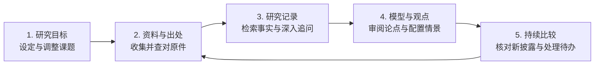

# Dalton Research OS

Dalton 帮助分析师持续研究特定行业的一组公司。它根据设定的研究目标收集资料，把定期财报、电话会纪要与研究报告中的信息整理成有出处的研究记录，用于更新公司分析、财务预测和情景估值。

分析师在网页中查看公司观点和财务预测，点击出处核对原文，调整情景概率，处理需要判断的事项。需要进一步研究时，可以围绕行业或一家公司提问，也可以下载带公式的 Excel 底稿继续分析。

## 第一次使用

打开网页，在顶部的「当前研究项目」中选择已有项目，或选择「新建研究项目…」。

创建新项目时，填写项目名称并输入初始研究目标，明确所关注的细分行业、覆盖公司与重点课题，再点击「创建并进入研究项目」。如果初始目标的信息清晰完整，系统在创建时可以直接发布首版目标；如果内容尚需补充，系统会先保存为草稿，分析师在新项目中补齐信息后核准发布。发布后，即可在「研究总览」中查看该项目的进展。

如果已经确定行业和研究问题，还没有选定公司，进入项目的「投研规则与设置」，让系统整理研究目标。系统会建议一组覆盖公司，核对股票身份，并列出每家公司的产业链位置和建议覆盖理由。审阅草案后，点击「确认覆盖范围并启动研究」。如果目标中已经指定公司，草案会保留这些公司；尚待核对的公司也会逐项列出。

## 平时怎样用

左侧导航包含五个页面：

1. **查看进展（研究总览）**：浏览覆盖公司的最新动态、近期催化事件和待处理事项数量，了解各家公司是否有新的资料入库或预期偏差。
2. **处理待办（待办决策）**：审阅需要确认的新论点、观点修订，以及研究范围或预算的调整。需要你决定的事项提供操作选项；系统补充资料、复核预测或修复任务的进展单独显示，并说明由系统继续处理还是由管理员检查。
3. **查阅与调整（公司研究）**：进入一家公司，先看本所观点、反向观点和具体分歧。点击带有出处标记的数据或结论，右侧面板会显示引用材料；已有原件时，可以继续打开财报或纪要核对原文。

   财务预测表展示历史数据与未来季度的预测。缺失单元格显示“—”，悬停或展开“缺失说明”可查看原因。有可用预测时，点击「下载财务预测底稿（.xlsx）」，可下载带公式和每行数据单位的 Excel 表格；部分科目缺少数据时，底稿也保留缺项说明。

   已有生效情景时，点击「自定义配置情景权重」，填写悲观、基准、乐观情景的整数概率与判断依据，三项概率合计为 100%。具备完整情景估值时，保存的权重用于计算加权目标价和期望回报；财务预测表及其 Excel 底稿按当前模型版本呈现。

   需要保存研究内容时，点击「导出公司研究全景报告（可在浏览器中打印为 PDF）」，可导出已经形成的研究章节。

4. **深入提问（智能投研问答）**：打开问答页面，提问范围默认覆盖整个行业；在「聚焦标的」中选择指定公司后，可提出具体问题，例如：“管理层最近一次电话会怎样解释云业务的订单增长？”收到基于已收录资料的回答后，点击「继续深入追问 →」可以在保留上一回答和出处上下文的基础上继续交流，也可以随时解除关联提出新问题。
5. **调整规则（投研规则与设置）**：随着研究推进，分析师可以在设置中增减覆盖名单、修订研究课题，或者调整投资建议的准入与纪律规则。在「每周投研周报」中设置时间和接收位置，生成后可在「最近几期」点击「查看周报」阅读。研究进展周报汇总项目进展、资料缺项与待处理事项，保存在工作台。

## 研究怎样积累

系统的研究过程由五个持续流转的环节组成：

系统按照分析师设定的目标收集公司向美国证券监管机构（SEC）提交的财报与公告、电话会纪要和研究报告，提取带出处的事实记录。这些记录用于维护各公司的季度预测、情景估值和投资论点。当公司披露新一期财报或关键公告时，系统将新数据与此前模型中的预测进行对照，梳理出潜在的偏差与变化，形成可供分析师查看和处理的研究结果。

从整体结构看，资料采集负责取得原文，语言模型负责阅读材料、起草研究内容和提出假设，核验任务检查结论与出处。研究记录和历次版本保存在同一个项目中，财务计算程序依据已记录的数据、建模假设和计算关系生成预测表与估值，网页工作台把这些结果呈现给分析师。研究任务按照项目设定的资料范围和预算运行；分析师负责确定研究方向、核对关键判断和处理待办。

## 与 AI Deep Research 有什么不同

常见的 AI Deep Research 用法是提出一个问题，等待检索与分析，拿到一份报告。Dalton 从一个持续覆盖的研究项目开始：确定行业、公司和重点问题，此后保存资料、更新模型、跟踪观点的变化。

| 比较维度 | 典型单次研究任务 | Dalton 持续覆盖工作流 |
| :--- | :--- | :--- |
| **工作组织** | 通常围绕一个具体问题，单次检索材料并交付一份完整报告。 | 围绕设定的细分行业与一组公司，持续维护多期数据与分析内容。 |
| **后续追踪** | 围绕本次提问交付；跟踪下一期财报时，再发起研究任务。 | 随着新财报与新事件披露，持续与过往预测和观点进行对照。 |
| **研究积累** | 产出多以单篇长文为主，历史背景留存在过往问答记录中。 | 保存历次获取的资料出处、事实推论、情景权重与投资论点版本。 |
| **财务模型** | 报告中多呈现静态财务数据或单一测算结果。 | 维护历史与未来对齐的季度与年度财务模型，支持带公式的 Excel 导出。 |

## 技术部署与维护

分析师在日常使用中直接访问已开通的网页端，新建研究项目、调整覆盖池和设置投研规则可以在界面中完成。

系统的安装部署、后台服务进程与外部数据接口由负责部署的人员维护。技术实现细节与部署说明可参阅以下文件：

* 运行状态与模块说明：[docs/PROJECT_STATUS.md](docs/PROJECT_STATUS.md)
* 系统规范与设计细节：[SPEC.md](SPEC.md)
* 部署与启动脚本：[docs/ops/deploy.sh](docs/ops/deploy.sh)
