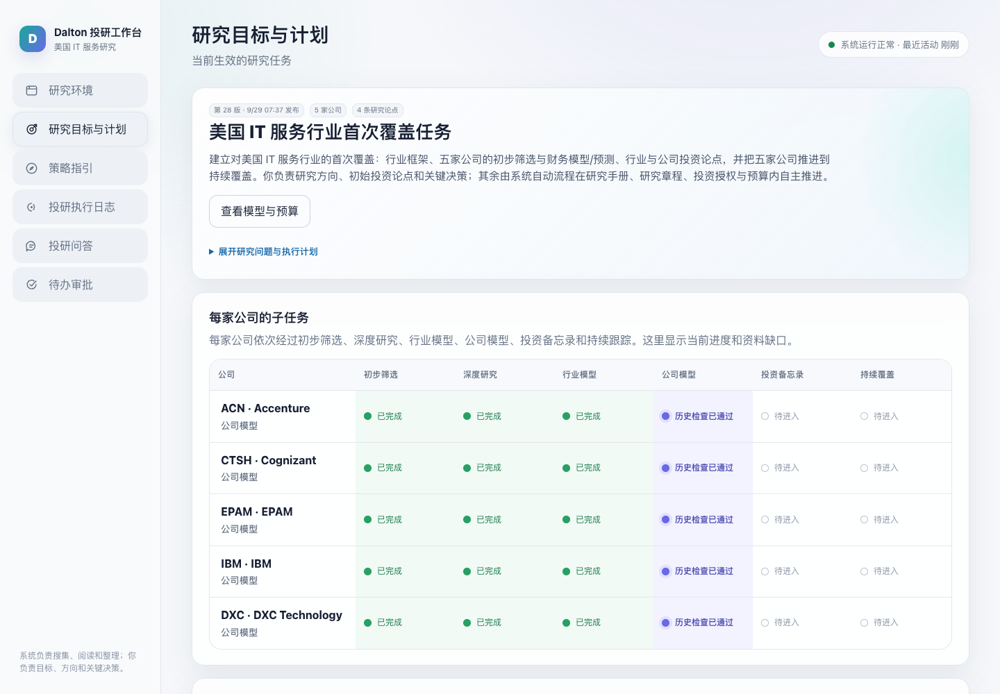
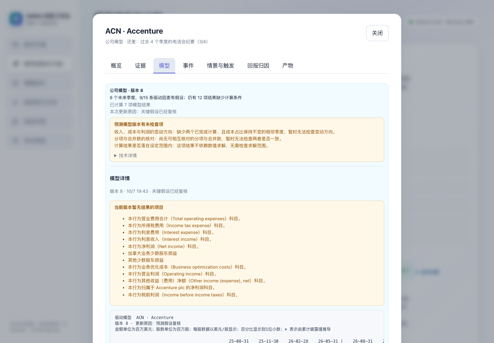
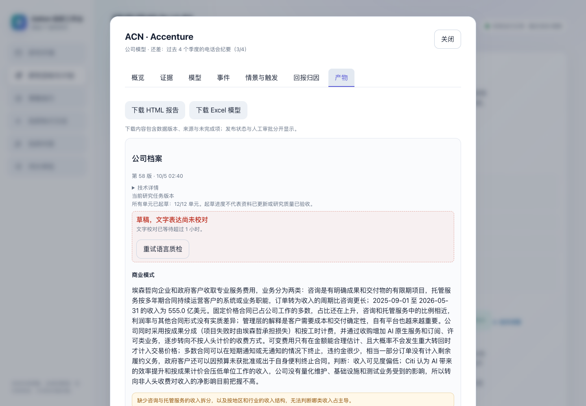
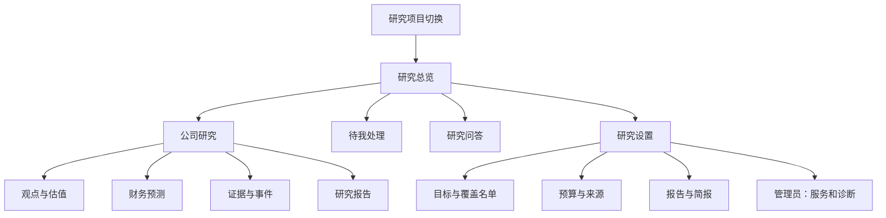

# Dalton Research OS Cockpit：面向非技术金融分析师的完整体验审查与改版建议

历史技术评审：保留当时结论与局限；当前运行状态见 [项目状态](../PROJECT_STATUS.md)。原始操作证据私有保存。

日期：2026-10-08。审查基线：主仓库 `7bb705ebad24034e4490c2f2d0945ab8370d0cd1`；浏览器读取当时正在运行的服务。本文是体验审查与修改方案，不是修复完成报告。

## 1. 结论与阅读方式

**当前 cockpit 仍然以“让使用者管理研究系统”为中心，尚未以“让分析师读懂研究、判断变化、完成决策”为中心。** 浅色主题、中文标签和折叠技术详情已经改善了外观，但信息架构、默认内容和操作责任仍保留了开发控制台的特征。主要问题不是缺少功能，而是重要信息埋得太深，系统内部工作大量转交给分析师，以及部分操作会丢失用户正在编辑的状态。

建议优先处理五件事：

1. 修复目标草稿、覆盖名单选择和未保存设置的丢失，以及常见笔记本宽度下的布局溢出。
2. 首页改为“研究结论、重要变化、待我决定”；公司页先给出投资观点、估值/回报、风险与下一验证事件。
3. 把模型链、运行凭证、连接器、脚本和重启等任务移到管理员界面；分析师只确认研究范围、成本和结论。
4. 把公司研究从长弹窗改为有目录的独立页面；报表用真正的表格，回报和情景用有金融意义的图表。
5. 重写业务文案和待办动作；每张需要用户处理的卡片必须提供能完成任务的入口。

配套文档：

本报告整理了 **114 项问题与改进建议（60 项 P1、54 项 P2）**，配套清单覆盖 **186 类按钮、链接和输入操作**，证据附件含 24 张截图。问题项包含交互缺陷、业务表达和设计改进，不应全部统计为软件故障。

- [逐按钮、输入项与条件分支审查清单](cockpit-analyst-ux-controls-2026-10-08.md)：现有操作、检查深度、保留/合并/迁移/修改建议。
- [页面覆盖、各公司差异及证据索引](cockpit-analyst-ux-evidence-2026-10-08.md)：逐页覆盖矩阵、实际测量、复现记录、截图。
- 较早的功能检查报告（历史证据原件已私有归档）：历史参考，不能直接当作本次现状；若有差异，以本次重新读取为准。

## 2. 范围、方法与判断边界

### 2.1 覆盖范围

| 范围 | 本次检查 |
|---|---|
| 美国 IT 服务研究（8793） | ACN、CTSH、EPAM、IBM、DXC；全部 6 个主页面 |
| 空白研究环境（8794） | 全部 6 个主页面、初始状态、资料来源和模型设置 |
| 美国 Hyperscaler 研究（8795） | AMZN、GOOGL、META、MSFT；全部 6 个主页面 |
| 公司详情 | 9 家公司 × 7 个标签 = 63 个标签页，另逐公司打开研究结论列表 |
| 全局阅读界面 | 数据源、模型与预算、每周复盘、运维待办、执行轨迹；无目标环境不可达的入口单独注明 |
| 独立页面 | 三环境的 `/weekly-brief`；三环境的 `/legacy` 及其待审、轨迹、问答、方向、议程 |
| 条件界面 | 草案确认、情景调整、反馈、核验顺序、模板上传、历史审批等，结合渲染代码与事件处理器检查 |
| 布局与交互 | 1440×1000 主检查；1280×800、1024×768、768×1024、390×844 补充；空输入、取消、分页、导出、刷新、键盘与错误状态 |

**“完整”指把当前页面拓扑及按钮实现列全，不等于执行了所有生产写入或穷尽未来数据状态。** 实际点击了导航、标签、阅读入口、列表分页、去重、导出、取消与不会提交的空输入校验。会批准研究、停机、改变预算、模型配置、情景或外发计划的成功提交路径，只审查实现，不在真实研究环境执行。表内分别标为 **B（浏览器实见/实测）、S（源码确认）、I（浏览器隔离模拟）**。同组件的重复按钮按操作类型审查，逐页实例列在附录。

隔离模拟中，目标草稿只是浏览器内构造的界面状态，没有创建真实草案；“99 点保存周报”请求在浏览器发出前被拦截，没有改动周报计划。读取故障也是浏览器主动注入，不是生产服务故障。报告中的行情、比例和研究文字仅为界面证据，未对其投资结论或财务底层计算作独立审计。

### 2.2 优先级

- **P1：优先修复**。会丢操作、误导状态/判断、阻断非技术用户完成必要操作，或损害核心阅读体验。
- **P2：下一轮改版**。功能能完成，但理解、查找或操作成本明显过高。
- **P3：细节完善**。一致性、语言和低频体验问题。
- 本次没有把主观审美问题标为 P0，也没有把缺数据本身一概判为软件缺陷。

## 3. 跨页面问题：先修交互底座，再做页面美化

| ID / 级别 | 现状与影响 | 修改建议 / 验收要求 | 证据 |
|---|---|---|---|
| G01 P1 | 主导航按系统内部流程分组：目标、策略、日志、审批。没有直接的“公司研究”“研究报告”“重要变化”入口。分析师先得理解系统。 | 导航调整为“研究总览 / 公司研究 / 研究问答 / 待我处理 / 研究设置”；研究项目作为顶栏切换器。日常阅读不经过设置页。 | B：三环境主导航；S：`show`、页面结构 |
| G02 P1 | 同一绿灯“系统运行正常”与页面中的受阻任务、无法定稿并存。绿灯实际上主要说明后台有活动，不能代表研究健康。 | 分开显示“后台在线”“研究受阻 N 项”“数据更新于…”；总览按业务影响聚合，不用单一正常状态覆盖局部失败。 | B：8793 首页绿灯与 27 项受阻；S：`svc` |
| G03 P1 | 页面只切换 DOM，URL 不随导航/公司/标签变化；返回、刷新、书签无法还原位置。 | 主页面、公司、标签、筛选有稳定 URL；返回应恢复原页面、筛选和阅读位置。 | B/S：`show`、`openCompany` |
| G04 P1 | 从策略页底部切到问答，滚动位置由 3366 保留到 2069，直接落在历史回答中，用户看不到提问区。 | 首次进入页面回到顶部；再次返回按明确规则恢复该页位置，不能继承另一个页面的滚动值。 | B：`navigation_scroll` |
| G05 P1 | 1024 宽度下页面实际宽 1292；768 宽度下宽 1060。正文、右侧矩阵被屏幕截断。 | 网格列允许收缩，主区域 `min-width:0`；横向滚动限制在必要表格内部。768/1024/1280 下正文和主要按钮完整可见。 | B：响应式测量及截图；S：`.app/main/.journey-grid` |
| G06 P2 | 所有内容都采用大圆角卡片、浅阴影、浅背景，重要结论、普通说明、错误和配置缺少层级；空历史也占整张大卡。 | 建立主结论、辅助数据、异常提醒三层视觉；少用外层卡片；空历史缩为一行。装饰面积让给数据与操作。 | B：首页、策略页、公司页截图 |
| G07 P1 | 浅色主题仍残留深色主题颜色：危险按钮粉色字极浅；未来状态用 `#8792a3` 小字；新增/删除草案色仍为浅绿/浅粉。 | 用统一语义色替换叠加覆盖；危险按钮保持清楚可读，删除差异不仅靠颜色。不要只修改全局背景色。 | B：紧急停机截图；S：`button.danger` 比后面的 `.danger` 优先，`.draft .add/.rm` |
| G08 P1 | 四张总览可点卡片为 `div`，日志筛选为 `span`，`tabIndex=-1`，键盘无法正常操作这些入口。 | 使用原生 button/link；筛选提供按下状态与名称；键盘走完与鼠标相同的主要任务。 | B：`keyboard_targets`；S：`panel`、日志 chips |
| G09 P2 | “模型”既指 AI 服务又指公司财务预测；“版本”可指研究目标、模型、报告、策略；“待办/待决/需要你处理/运维待办”多套名称。 | 区分“财务模型”“AI 服务”；版本必须带对象名称；统一“待我处理”，内部再按任务种类分组。 | B/S：全站 |
| G10 P2 | 主要表单依赖 placeholder，当输入后字段提示消失；很多状态区没有实时播报语义，错误和成功只短暂 toast。 | 持久字段标签；字段旁就地校验；提交结果留在对应对象上。toast 只作补充，不承担唯一反馈。 | S：表单结构、`toast`，B：空输入检查 |
| G11 P1 | 公司详情和更多阅读界面复用一个弹窗；打开结论列表会覆盖公司页，关闭后直接回到首页，公司标签和阅读位置丢失。 | 公司研究用独立页面；来源/原文用可返回的侧栏。嵌套阅读必须有“返回公司研究”。 | B：ACN→产物→研究结论→关闭；S：`prepareReader`、`replaceChildren` |
| G12 P2 | 弹窗 focus trap 枚举隐藏标签页控件且漏掉普通链接、summary；实测在公司概览从“关闭” Shift+Tab 仍停在关闭按钮。加载态常没有可见关闭按钮。 | 聚焦序列仅包含当前可见交互；标签页建立 `aria-controls/labelledby`；加载与失败都保留关闭/重试。 | B/S：`dialog_reverse_tab`、键盘处理、加载函数 |

## 4. 六个主页面的逐页审查

### 4.1 研究环境

| ID / 级别 | 问题 | 建议与验收 |
|---|---|---|
| W01 P1 | “继续使用现有连接”直接显示 `service.json`、`bounded_planner`、`thesis_impact`，要求运行 `docs/ops/reexport-runtime-templates-2026-09-30.sh`；下方却承诺“只需设定研究目标”。 | 分析师只看“新项目配置需要更新，由管理员处理”；提供可完成的修复转交入口和明确可否继续。脚本只保留在管理员诊断页。未修复前不作“已准备好”的笼统承诺。 |
| W02 P2 | “环境、连接配置、启用检索与读取、研究流程”暴露部署概念；用户实际想建立一个行业/公司研究项目。 | 主名称改“研究项目”；输入“项目名称”，按钮“新建研究项目”。解释只保留“资料和结论单独保存”。 |
| W03 P2 | 项目列表只有名称和“可以进入”，没有待办、最后更新、研究公司数；当前项目也显示“可以进入”。 | 每行显示公司数、最近更新、待办数；当前项目只标“当前项目”。大幅减少每次进入前的猜测。 |
| W04 P2 | “新建空白研究环境”后还要再进入，再设定目标；重命名用浏览器原生 prompt。 | 新建项目流程合并为“名称与目标→范围确认→开始”；重命名用列表内编辑，保留取消和校验。 |
| W05 P2 | 每周简报设置放在新建项目说明中，与用户建立研究的任务无关。 | 移到“报告/简报”或研究设置；已存在项目的常用动作优先于新建说明。 |

### 4.2 研究目标与计划 / 首页

| ID / 级别 | 问题 | 建议与验收 |
|---|---|---|
| H01 P1 | 首屏没有投资结论、观点变化、报告入口或明确待办；醒目操作却是“查看模型与预算”。 | 先显示“今天的变化”“待你决定”“公司摘要”；研究目标缩为一段可展开说明；AI 服务设置移出首屏。 |
| H02 P1 | 阶段矩阵只显示“已完成/待进入/历史检查已通过”。前序完成由当前位置推断（`stageState`），不代表当前资料/研究成果已齐。 | 将“阶段位置”“最近评审结果”“资料是否齐全”分开，不能用推断的绿色格子代替验收状态。点击状态应进入相应内容。 |
| H03 P2 | 只有公司名可点，阶段格子不是操作；六列矩阵占很大面积却不显示观点、回报或近期更新。 | 默认公司表：公司 / 核心判断 / 最新变化 / 估值或回报 / 下一事件 / 待办。研究阶段作为次级进度列。 |
| H04 P1 | “待补齐资料缺口”把未读文档数与行业框架缺项相加，如 3+1342=1345；点击进入的是数据源目录，不是缺口清单。 | 区分“缺少 N 项关键资料”和“还有 N 份资料待阅读”；点击查看具体公司、期间、影响与补充动作。 |
| H05 P2 | “找到的资料、已读资料、入库结论（含重复版本）、模型调用”偏生产量，不帮助判断研究价值；并列数字口径不一致。 | 首页用“新增重要结论、已完成报告、待决问题、资料时效”；内部量与成本放运行统计；去重与时间范围必须清楚。 |
| H06 P1 | 目标草稿会被总览刷新清空。隔离模拟先渲染带确认按钮的草稿，再执行正常读取，草稿变为空。`renderOverview` 每次清空 `goal-draft/goal-status`。 | 草稿与总览数据独立管理；轮询、切页、失败不能丢草稿；有未确认草稿时恢复同一草稿而非重新付费生成。 |
| H07 P2 | “设定新的研究目标”在已有研究首页底部长期展开，容易与新建项目、调整当前目标混淆。 | 分成“编辑本项目目标”和“新建项目”；默认不展开大文本框；确认页给出具体变更。 |
| H08 P1 | 目标草案中发现新公司，却提示“尚未覆盖，需要另行接入”；目标里增加公司与真正覆盖名单分属两条操作链。 | 用户自然语言要求增加公司时，生成统一的范围变更草案；明确哪些公司会开始研究、费用变化，一次确认完成。 |
| H09 P2 | 空项目同时出现“等待第一个研究目标、设定研究目标、设定新的研究目标、整理并准备开始研究”，信息重复；自动配置已准备的说法与配置过旧告警不一致。 | 一个标题、一句例子、一个输入区、一个“下一步”；配置问题用独立状态，不混在新手操作文案里。 |

### 4.3 策略指引与方向调整

| ID / 级别 | 问题 | 建议与验收 |
|---|---|---|
| S01 P1 | 一页塞进方向调整、历史、运行控制、投资规则、模板、覆盖名单。8793 默认约 3693 px，展开后约 10023 px。常用覆盖名单在最底部。 | 拆为研究范围、投资规则、报告模板；公司暂停/优先操作放公司行菜单。运行维护移管理员。 |
| S02 P2 | “之前的方向调整”为空仍占一整张大卡；本次调整旁没有当前目标或问题，要求用户去另一页查看。 | 空历史收起；在编辑侧栏显示当前目标和问题，改前/改后直接对照。 |
| S03 P1 | 公司/流程动作共用页面上方一个理由框，理由会被多个按钮重复使用；暂停时长是任意小时数，永久暂停靠留空表达。 | 对象内弹出操作表单：对象、动作、到何时、原因；选项“1 小时/明天/指定时间/手动恢复”。完成后显示状态与撤销/恢复入口。 |
| S04 P2 | “优先看这家”实际提高资料跟踪频率，不一定立即安排深入分析或改变研究排序。 | 根据真实效果改“提高更新频率”，说明从何频率到何频率；若提供“优先研究”，则应确实改变研究队列。 |
| S05 P1 | 覆盖名单复选框被每 30 秒的 `loadLevers` 重建；实测勾选 1 项后刷新变成 0 项。 | 服务状态刷新不能覆盖用户的未提交选择。验收：编辑两分钟、后台多次刷新，所选名单、理由、覆盖等级均保留。 |
| S06 P2 | 新增公司只能填代码并用逗号分隔；草案突出 SEC CIK；“覆盖等级 A/B/C”对实际研究深度解释不足。 | 支持公司名/代码搜索、多选、市场区分；CIK 放数据详情；直接显示“重点/常规/观察”及频率和成本影响。 |
| S07 P2 | 投资策略标题带 `Conviction v2`，状态“代码默认”，普通用户需理解版本算法；阈值表过长，发布按钮缺少结果预览。 | 显示“投资建议规则 · 使用系统默认”；先显示影响决策的少数规则；修改时列出哪些现有建议将改变，保留审计版本但不突出技术代号。 |
| S08 P2 | 财务模板操作要求填写 slug、三个工作表名、分类，并理解四级优先级；上传后还需另行指定。 | 文件上传后自动识别工作表，用下拉确认；系统生成内部代号；“保存并用于哪些公司”一步完成。解释当前模板的来源即可，不要求记忆整个继承链。 |
| S09 P2 | 一家公司反复出现模板名、版本、当前来源，再加选择框和长按钮；全部使用“AMZN 样本”会让其他公司用户担心输出错公司。 | 默认显示模板预览与“更换/导出”，通用模板用业务名称；若适配有限，应标明支持的业务模型，不能只做改名掩盖限制。 |
| S10 P2 | “取消指定/取消/恢复系统内置”语义不同但视觉相似；模板设置理由位于远离动作的位置，错误提示要求“先在上方写理由”。 | 明确“恢复项目默认/恢复行业默认”；每次变更在当前位置确认影响范围和原因。 |

### 4.4 投研问答

| ID / 级别 | 问题 | 建议与验收 |
|---|---|---|
| A01 P1 | 历史回答呈现几百字到上千字连续长段，重要结论、缺口、引用和费用混在一起；用户难以快速拿走结论。 | 默认“结论 1–3 条 / 关键数字 / 主要依据 / 尚不能确认”；完整推理折叠。多公司比较用表格。 |
| A02 P2 | 没有公司/期间上下文选择、历史检索、问题分组；示例为固定 IT 服务公司，空项目与大科技项目仍复用。 | 继承当前公司/项目，提供可见的范围选项和动态示例；历史按问题分组，可搜索、重问与继续追问。 |
| A03 P1 | 标题叫“对话”，实现提交的是单条 `question`，界面没有清楚说明是否继承上一轮。用户说“那它的利润率呢”可能误以为上下文已绑定。 | 实现会话上下文并展示当前研究对象，或清楚命名“问题记录”，提供基于某条回答的追问入口。此处是契约不清，不断言后端一定不能理解代词。 |
| A04 P2 | 失败记录虽然已能说明输入过长，但没有“缩小范围重问”；长任务循环等待，无取消/转后台/明显持久任务入口。 | 提供“编辑后重问”，自动带回原问题；等待态显示阶段，关闭页面后能恢复任务；区分取消显示与取消执行。 |
| A05 P1 | 五个反馈按钮“已审阅/可用于研究判断/仍需补充证据/不认同当前结论/需要修订”混合阅读状态、采纳、证据质量；实现可并列累计，看不出当前意见。 | “已读”独立；主要反馈为“有帮助/有问题”，问题再选原因；需要形成正式审阅决定时另走明确审批。可修改反馈，展示最新有效状态。 |
| A06 P2 | “草稿，文字表达尚未校对”“发布时没有文字校对环节，之后也不会自动校对”让用户承担历史系统实现知识；费用精确到四位小数。 | 状态应说明可否引用、待核实什么；历史说明放版本详情。费用按有用精度显示，详细账单另看。 |
| A07 P2 | 引用在回答末尾统一展开，长答案难以判断哪条来源支持哪句话；0 引用、高低置信度、查阅条数的含义不够统一。 | 关键论断就地编号引用；显示文件名、发布日、页码/段落；置信度基于证据完整性解释，不以模型“自信”替代。 |

### 4.5 待办审批

| ID / 级别 | 问题 | 建议与验收 |
|---|---|---|
| D01 P1 | 上方“需要你处理（7）/（5）”，下方又说“目前没有需要你决定的事项”；侧栏徽章只统计后者。 | 统一为“待我处理”，分“研究决策 / 资料补充 / 服务问题”；徽章应覆盖实际要求用户采取行动的条目。 |
| D02 P1 | 用户被要求选择模型链、理解 `research_localization_verifier`、执行凭证、`--apply`、存储环境变量和重启。 | 管理员任务单独路由；分析师看到“影响哪些研究、是否需要改变范围/成本、预计下一步”。不能只把脚本藏起来，动作必须能闭环。 |
| D03 P1 | GOOGL/MSFT 缺纪要时要求改 AlphaEngine 检索计划或取消要求，按钮却只跳到目标页，那里没有对应计划编辑控件。缺文件时“资料来源”也只是目录。 | “补充电话会纪要 / 重新搜索 / 暂不要求该资料”直接打开对象相关表单；有权限/质量影响的选项明确解释，不让用户跨页找不存在的入口。 |
| D04 P1 | 对失败研究提供“停止这条研究线”，而继续研究需要管理员命令；简单的停止动作比保留研究更容易。 | 并列“重试研究（预计费用/上限） / 暂缓 / 停止研究”；无法自动恢复时提供实际转交动作和跟踪状态，不能假装已提交。 |
| D05 P2 | 一张总括卡和两张具体问题卡反复解释同一故障；MSFT 两条融资租赁问题近似重复；“为什么/你要做什么/哪里/后果”每卡长段堆叠。 | 按用户决策对象归组，保留问题版本；卡片默认三行：影响、建议、动作；历史尝试折叠。聚合不应误合并实质不同问题。 |
| D06 P2 | “不需要做任何操作”的 8-K 缺附件也列在“需要你处理”；“不处理一直不产出”等措辞给用户不必要压力。 | 无需动作的状态进“系统正在处理”；异常提示用事实和影响，不用责备或威胁。 |
| D07 P1 | 空白项目提示“占着端口和进程”，按钮“研究环境 页”又把用户带到项目管理页，而不是写目标的输入处。 | 空态按钮直接“设定研究目标”，在正确输入框定位并聚焦；不显示端口/进程。 |
| D08 P1 | `loadNeedsHuman` 读取异常直接吞掉。初次失败时卡片可能隐藏，用户误以为无事；已有内容失败时没有更新时间警示。 | 明确“待办暂时无法更新，以下为上次结果”，保留重试及更新时间，不能把读取失败表现为没有待办。 |
| D09 P2 | 决策按钮颜色按拒绝/非拒绝简单划分，多种非拒绝动作都用主色；成功后卡片消失，缺乏持久回执和下一结果链接。 | 每项只选一个推荐主动作，其余次级；完成后显示“已决定/执行中/已生效”的阶段和结果链接，保留审阅记录。 |

### 4.6 投研执行日志

| ID / 级别 | 问题 | 建议与验收 |
|---|---|---|
| L01 P2 | 日志作为一级导航，默认全量时间线约 1.3 万字符；大量模型/采集动作不代表研究观点变化。 | 一级展示“研究动态”：新结论、重要事件、观点调整、报告完成；机器日志归管理员/诊断。 |
| L02 P2 | 只有动作类型筛选，没有公司、日期、重要性、失败是否已恢复的筛选。 | 分析师按“公司/时间/影响”找信息；相关多条技术事件聚成一个业务事件。 |
| L03 P2 | “打开执行轨迹（每步调用了什么、结果如何）”长按钮重复解释；时间线和轨迹是两个相近入口。 | 普通用户保留一个动态列表；管理员入口叫“查看运行记录”。 |
| L04 P1 | 轨迹说“向上滚动即暂停跟随”，实际判断 `sheet.scrollTop`，滚动的是外层 `reader`。实测外层 700、内层 0，跟随仍开启，下一轮刷新会重建列表。 | 监听真实滚动容器；阅读旧记录时保持位置和展开项；出现新记录只提示“有 N 条新动态”。 |
| L05 P2 | 轨迹顶部 4px 彩条没有业务数值，颜色主要靠 tooltip，条块并不是可读的投研图表。 | 维护页才保留时间总览，添加时间轴、图例和状态文本；投研页用事件时间线，而不是装饰性的瀑布条。 |

## 5. 公司研究：七个标签全部审查

### 5.1 共性与概览

| ID / 级别 | 问题 | 修改建议 / 验收 |
|---|---|---|
| C01 P1 | 900px 弹窗内承载七个标签和数万字研究；背景被遮罩，无法同时对照两家公司。 | 公司页使用完整工作区域；支持在新标签打开、固定目录、返回列表保留筛选。短提示才用弹窗。 |
| C02 P2 | AMZN·AMZN、GOOGL·GOOGL、META·META、MSFT·MSFT、IBM·IBM 重复显示代码；没有正式/常用公司名。 | 显示“微软 MSFT”等可识别名称，市场/币种作辅助；缺名称时不重复代码。 |
| C03 P1 | 默认“概览”只有市场、阶段、清单、数量，没有当前投资判断、核心争议、目标价/预期回报与风险。 | 第一屏形成研究摘要：观点及状态、最关键依据、预期回报口径、主要风险、下一验证事件；没有结论时直说，不制造评级。 |
| C04 P1 | 清单“过去 4 个季度”显示 26/4、34/4；年报已取 1/1打勾，但全文已读 0；“历史检查已通过”与当前缺资料并列。 | 分清“拥有历史 N 季”“最近 4 季覆盖 3/4”“全文已读”；打勾必须对应用户看到的业务要求，不以获取替代阅读/核验。 |
| C05 P2 | 股价用 5D/30D/90D再加中文括号；仅给数字，未突出行情截至时间与交易所时区；没有趋势图。 | 简写“近 5 日/1 月/3 月”，价格旁显示截至日与延迟属性；提供小型价格趋势并标出重大事件。 |

### 5.2 证据

| ID / 级别 | 问题 | 修改建议 / 验收 |
|---|---|---|
| E01 P1 | 证据页混合初筛报告、最新结论、提取数据；部分最新结论仍是整段英文，且没有清楚的文件入口。 | 以论点→支持/反证→来源组织；中文摘要配可展开原文，金融原始术语保留；证据来源可直接定位。 |
| E02 P2 | “查看公司研究结论”在产物底部，证据页反而只展示少量最新记录；全量列表每页 50 条，无关键词搜索。 | 证据页提供搜索、公司/主题/期间/来源过滤；把“已核实结论”作为这里的列表，不藏在长报告尾部。 |
| E03 P1 | 研究正文中的来源有长段重复陈述，也有“已绑定来源 · 已绑定来源”，既不短也不具备可核查性。 | 来源显示真实文档标题、日期、页码与原文链接；正文只放编号。不能用“已绑定”替换识别信息后宣称已解决代码露出。 |
| E04 P2 | 去重开关文案整句“已合并重复（点击展开全部）”，普通阅读者没有必要面对存储版本。 | 默认“合并重复”开关，旁边显示当前结论数；全部历史版本置于审计模式。实测分页与去重可用，应保留。 |

### 5.3 财务模型

| ID / 级别 | 问题 | 修改建议 / 验收 |
|---|---|---|
| M01 P1 | 核心模型用 `pre.table` 等宽纯文本；ACN 可见宽 798px、内容宽 1386px，12px 字体，行名与数据分行、无法固定首列。 | 用语义表格，固定科目/期间，数字右对齐；历史/预测明确分界；年度/季度切换，缺数据用“—”及原因。 |
| M02 P1 | 一屏先显示多段核验说明和 12 项缺结果，再出现数据；“本行为收入（Revenues）科目。”被当作行名，噪音很高。 | 科目直接叫“营业收入”；先给关键预测与完整性摘要，具体缺口按受影响行展开。说明书不能成为财务科目。 |
| M03 P2 | “变动方向未检查”“数值求解不适用”等技术检验与真正缺净利润同为黄色警告。 | 将阻止使用预测的重大缺口、需注意假设和不适用检查分级；不适用检查不占主界面。 |
| M04 P1 | 不完整模型仍有可导出按钮；用户需读长说明才知道哪些数字是正式结果、哪些尚缺。 | 导出前可见“包含哪些预测/哪些缺失/依据哪期数据”，Excel 同步醒目标注；不必阻止有用的部分导出，但不得使其看似完整。 |
| M05 P2 | MSFT 空白问题已修复，但现提示仍包含“模型规格、报表行、驱动因素”；没有具体下一步入口。 | “还缺 1 份电话会纪要，补齐后生成预测。”并提供查看缺口/补充资料；若并非唯一条件，应列准确的阻碍而非承诺。 |
| M06 P2 | 模型版本链是文字列表，没有“这次究竟改了哪些假设和结果”的比较。 | 默认“本次变化”：收入增速/利润率/估值变化及理由；完整版本记录二级展开。 |
| M07 P1 | IBM 模型仍直接出现 `us-gaap:NetCashProvidedByUsedInOperatingActivities`、`us-gaap:PaymentsToAcquirePropertyPlantAndEquipment`；AMZN 估值指标仍是英文长名，现金流收益率显示 `-0.004` 而未标百分比/比例口径。 | 财务科目元数据独立于正文翻译；估值用“市盈率（倍）/市销率（倍）/自由现金流收益率（%）”，先确认原始比例尺度再换算。来源原字段只在审计详情保留。 |

### 5.4 事件

| ID / 级别 | 问题 | 修改建议 / 验收 |
|---|---|---|
| V01 P1 | DXC 新事件标题仍为 `sec:filing:0001688568-26-000068`；判断正文可能数百字并重复，多条相同回购判断连续出现。 | 事件标题改为文档真实业务标题，未知时“新披露文件，内容待读取”；按同一事件去重，展示“一句话影响 + 受影响假设 + 原文”。 |
| V02 P2 | 催化剂只显示 T−N、日期未确认；正文按 UTC，其他页面按浏览器或上海时间。GOOGL/MSFT 只有催化剂卡，没有清楚的“近期尚无新事件”。 | 统一展示用户时区，财报日期保留公司公告/预计标记；催化剂与已发生事件分区，零事件给出明确空态。 |
| V03 P2 | 事件、研究判断、后续任务、核验状态混为单行；总计上千条但仅显示少数最新，未说明列表范围。 | 展示条数和时间范围；默认重大变化，其他展开；按事件向下查看完整处理链，不让分析师读内部状态串。 |

### 5.5 情景与触发

| ID / 级别 | 问题 | 修改建议 / 验收 |
|---|---|---|
| Q01 P2 | 三个情景各自长段排列，没有并排比较概率、关键假设、股价/回报；读者很难比较乐观与悲观差异。 | 三行对照表加概率条：情景、概率、关键假设、回报区间、触发指标；长叙述二级展开。 |
| Q02 P1 | 调整单个概率用两个原生 prompt；看不到其他情景及总和，提交成功还关闭整页。 | 同一表单调整整组概率，实时显示合计及回报变化；不强行隐式归一化；确认后留在原位置。 |
| Q03 P1 | “由你判断，程序不读”的条件没有“已满足/未满足/待确认”操作；用户被告知负责，却没有完成任务的控件。 | 提供人工判断及依据录入，保留日期/操作者；如果不支持，不能呈现为待用户执行的功能。 |
| Q04 P2 | 阈值与最新值过度四舍五入，例如“收入 >187.2 亿美元”旁也是“最新187.2”，却显示未触发，读者难以理解。 | 阈值比较使用足够精度或显示“距阈值还差…”；单位、报告期、方向与触发状态同列。 |
| Q05 P2 | 无情景时说“等你在待办里裁决”，实际导航叫待办审批；没有去往提案的链接。 | 空态说明生成条件；已有待审提案则提供“查看情景提案”。术语统一为“确认/调整”。 |

### 5.6 回报归因

| ID / 级别 | 问题 | 修改建议 / 验收 |
|---|---|---|
| R01 P1 | 实现回报、模型预期、一致预期和卖方目标价并列，关键限制在表下长脚注。ACN“我们的驱动模型”实际以收入×历史净利率作代理、股数持平，主标签没有反映估算性质。 | 主行明确标“简化估算：历史净利率/股数不变”；实际与预期分开；证据不完整的预测不用同等视觉确定性。 |
| R02 P1 | 已实现回报说明采用“不是当时已知的数”的 EPS；若读者将其当可回测的当时投资依据，会误用。 | 主标题标“事后财务归因”；与当时可得数据口径区分；若做决策回测，必须另用当时已披露数据。不是要求删除这项说明，而是提升其位置。 |
| R03 P2 | 所谓利润桥和回报分解都是纯表格，没有桥图；表格列多，脚注密集。年度、累计、单季数据在同一长列表。 | 增加回报贡献瀑布图与利润桥，保留表格；期间选择默认单季，年度/累计单独切换。图不能混合不同口径。 |
| R04 P2 | EPS、股息小数位不一致（如 4.8898、1.6258），利润表单位与模型不一致；少数股东行可能重名。 | 设统一显示精度、单位切换与完整值 tooltip；不能为简短而合并经济含义不同的科目。 |

### 5.7 产物 / 报告

| ID / 级别 | 问题 | 修改建议 / 验收 |
|---|---|---|
| O01 P1 | 标签名“产物”是工程词；所有报告、正文、来源、缺口与反思默认铺开。9 公司中最长 META 62636 字符；IT 服务五家公司均约 5 万字符。 | 改“研究报告”；先显示报告列表、摘要、状态、更新日，点击后进入单篇阅读器；目录固定、章节按需展开。 |
| O02 P1 | 业务正文之后拼接多条来源陈述，内容重复；“当前任务版本/所有单元已起草/不代表质量验收”等常驻说明进一步挤占阅读。 | 正文一次表达结论；来源缩成编号；用统一报告状态组件表达是否可使用，详细审计元数据移版本详情。 |
| O03 P1 | 草稿语言校对告警可占半屏，按钮“重试语言质检”让分析师管理内容流水线。某些内容长期草稿仍可导出。 | 自动处理校对；正文保留明确“未审核”标识与使用边界；若需人决定，说明“先看草稿/等待定稿”，技术重试转管理员。 |
| O04 P2 | 下载叫“HTML 报告”，用户被迫理解文件格式；报告、Excel 和模板设置分散。 | 用户动作叫“下载研究报告/导出财务模型”；菜单再选实际支持的格式。若要 PDF/Word，必须实现后才提供。 |
| O05 P2 | 没有一屏摘要、目录、章内搜索、打印优化入口；核心争议多次以相同“研究内容”作标题，难以识别问题、双方观点和结论。 | 目录用真实主题；核心争议结构化为“问题/市场看法/我们的判断/证据/下一验证”；保留全文但不默认展开。 |
| O06 P1 | 大科技四家公司报告的资料缺口仍直接显示 `gap:ws-…:mission-specific-evidence`、`gap:high-frequency-demand`，并带完整英文解释；同行比较还有“columns are calendar quarters…”夹中文句子。 | 缺口使用稳定业务标签与可执行动作，内部标识仅作诊断；比较表明确自然季度/财季对应关系，用简洁中文说明而不删除期间限制。 |

## 6. 全局弹窗与独立页面

### 6.1 模型与预算

| ID / 级别 | 问题 | 修改建议 / 验收 |
|---|---|---|
| X01 P1 | “查看模型与预算”打开大型可编辑控制台：四类调用顺序、每环节输出上限、核验家族、网关目录。默认弹窗内容高约 23248 px。分析师为了改预算先经过大量模型配置。 | 分析师页仅显示预算、用量与研究服务是否可用；“AI 服务设置”单独管理员页。保留高级配置能力，但不作为普通工作流必经之路。 |
| X02 P2 | 左右穿梭框、箭头、每项移除与“从链中移除”重复；模型名被挤成三行，备选项有同名重复，无法理解区别。 | 用推荐研究服务方案；确需高级排序时单列表、可搜索添加、提供服务来源/能力差异。移除操作只留一种。 |
| X03 P1 | 移动模型后 Escape 直接关闭，重开恢复原值，无未保存提醒。多个保存按钮还可能重建整个弹窗；源码仅对部分链编辑做保护。 | 表单统一 dirty 状态，关闭需保存/放弃/继续编辑；各设置独立局部更新，不能因保存预算/输出上限清空其他未保存更改。 |
| X04 P1 | 保存模型可能同步所有环境，有些环节需重启；重大作用范围在长解释中，按钮只叫“保存”。 | 保存前明确项目范围及生效时点；系统自动验证独立核验要求；需要管理员重启时进入明确的待生效流程。 |
| X05 P2 | “补充模型信息”让用户手填家族和逗号分隔能力；已退役环节仍可见输出上限；过多无效选项增加误操作。 | 模型元数据由连接目录/管理员维护；隐藏退役环节；不可选项解释原因，默认不列出整屏不可用模型。 |
| X06 P1 | 资料来源页展示的高阶链与模型设置当前链不同；待办声称独立核验冲突，设置页又显示全部独立。可能是历史事件/配置不同口径，但界面没有说明。 | 每个状态标明“当前配置/上次实际执行/历史故障”与时点；修复后旧待办自动更新或标待重试，不能让用户自行解释冲突。此项要求核对数据口径，不断言后台路由错误。 |

### 6.2 资料来源、每周复盘、运维待办

| ID / 级别 | 问题 | 修改建议 / 验收 |
|---|---|---|
| X07 P2 | 数据源目录列出与美股项目无关的沪深港来源；“目录已登记、研究权限已连接、目标未声明、没有基线”等并列，状态难读。 | 默认只列本项目来源：已连接/需登录/未启用/不可用；每项显示最近成功更新与业务范围；其他来源放“添加来源”。 |
| X08 P1 | 来源目录没有重新登录、重新连接、补传资料动作，却被待办当作解决缺资料的终点；下半页又讲模型链。 | 来源详情必须承接重连/补资料/更换来源；删除模型链重复内容。暂不可自动操作时提供真正的管理员转交记录。 |
| X09 P2 | 每周复盘围绕调用次数、预算、撤下结论、规划问题数量；“没有评分是否评分未接入”等开发自检问题还需用户解答。 | 分析师周报先列观点变化、重要证据、未决风险与下周事件；运行效率复盘归管理员。候选研究建议可直接加入待办，并显示成本和范围。 |
| X10 P1 | “当前受阻”明细出现 9 月旧失败，文案却说“今天预算不足”；服务已变化后仍缺少当前是否受阻的清楚时间语义。 | 读取当前状态并标最近确认时间；历史事件保留原发生日期，不用今天措辞；业务影响归并为公司/报告。 |
| X11 P2 | 运维待办只有状态和历史，缺少由谁处理、处理进度、相关研究链接；同一原因多次重复。 | 用户侧以“影响的研究/处理中/需你决定”呈现；管理员侧保留错误组与详细追踪。 |

### 6.3 每周简报 `/weekly-brief`

| ID / 级别 | 问题 | 修改建议 / 验收 |
|---|---|---|
| B01 P2 | 独立页使用另一套样式、宽度和按钮色，离开主导航与项目身份；返回只能去首页。 | 纳入工作台壳层，始终显示所属项目；返回原入口。 |
| B02 P1 | 要求手写 `America/New_York` 和“目的地”；实际期望后端已连接频道引用，非技术用户无法填写。 | 时区用可搜索城市/时区选择；目的地用“仅保存在工作台/发送到已连接频道”选项与频道名，内部地址不可手填。 |
| B03 P1 | 历史时间格式化固定上海时区，但表单默认纽约，表格没有标时区；“没有设定”下又有历史计划，没有解释。 | 全页使用用户选择时区并注明；显示“当前无启用计划，以下为历史记录”；直接预览下一次运行的完整日期时间。 |
| B04 P1 | 输入小时 99，前端仍尝试提交；隔离拦截后显示英文 `Failed to fetch`。`min/max` 没有形成表单提交校验。 | 提交前验证星期/时分/时区/目的地；错误放字段旁。后端仍须校验；此测试未证明后端会接受 99。 |
| B05 P1 | “已送达本环境的简报”表格只是文件名、写入时间、大小；`table` 只填 textContent，没有阅读/下载链接。已有外发记录也无正文入口。 | 每期简报可以打开、下载，显示生成/发送状态及失败原因；历史记录不是只有交付地址。该能力缺失由源码确认，当前本地列表为空。 |
| B06 P2 | 只有保存计划，没有暂停、取消、预览；小时与分钟分两个数值框。 | 提供时间选择器、“启用每周简报”开关、内容预览和下次运行时间。保存外发设置前展示收件频道，避免含糊目的地。 |

### 6.4 历史页面 `/legacy`：五个页签

| ID / 级别 | 页面与问题 | 建议与验收 |
|---|---|---|
| Z01 P1 | 全页头部解释 Core、gate、Tailscale Serve、Evidence/Claim/production；视觉仍为深色另一套产品，没有回到主台的明显链接。 | 在业务入口迁移完成后归档为管理员历史记录，清楚标“旧版”；若仍有不可替代操作，先提供现代业务入口，不能直接隐藏唯一能力。 |
| Z02 P1 | **待审**：把文件查看→分段抽取→修正集 hash→引用起止坐标→候选 staging→登记完成暴露给用户。待审列表同时充斥已自动入库内容，8793 超过 8.7 万字符。 | 面向分析师合并成“原文—提取结论—确认/修订”；用选中文本绑定引用而非手填偏移/hash；已处理记录默认隐藏、可筛选分页。 |
| Z03 P2 | **轨迹**：虽然只读，说明仍是 authority/admission/只读投影，底层验证记录对业务无解释。 | 对象历史用“谁在何时基于什么改了什么”；内部标识只用于管理员诊断。 |
| Z04 P1 | **问答**：要求问题与已入库 ResearchQuestion 完全一致，出现 stale-only/ProbeTemplate/WorkOrder；与主问答的预期不同。 | 统一到主问答，语义匹配由系统处理；需要补资料时展示范围、费用、预计结果，不让用户理解路由。 |
| Z05 P1 | **方向**：typed candidate、exact context、writer 及 JSON effect 直接出现在界面；生成候选不等于修改生效。 | 统一到研究范围编辑，展示业务变更前后；后台一致性校验保留，但失败时说“内容已更新，请检查最新版本”。 |
| Z06 P1 | **议程**：声明已退役却仍显示同意/不同意，且没有明确这些决定现在是否产生业务效果。 | 历史只读并显示当年决定；若需要补记审阅，明确叫“补记历史意见”，不模拟当前任务审批。 |

## 7. 图形与视觉：应该增加什么，应该减少什么

### 7.1 应减少

- 大面积渐变、重复卡片框和阴影；它们让目标介绍、费用统计、缺资料与研究结论具有相似权重。
- 每条记录都配“技术详情”，以及同一事实的状态、解释、后果重复表达。技术诊断移管理员；业务来源仍保留且易查看。
- 极浅灰/浅粉/浅绿文字、小于正常阅读字号的关键状态、过长按钮文案、连续几屏告警。
- 没有量纲和可比较数值的“看起来像图”的装饰。图表必须降低判断成本。

### 7.2 应增加的金融图表

| 场景 | 推荐图形 | 必须同时呈现 |
|---|---|---|
| 公司概览 | 股价小趋势图，关键指标小表 | 数据截至时间、币种、事件标记、来源 |
| 模型 | 收入/利润率历史与预测折线，真正财务表格 | 历史/预测界线、期间、单位、缺失值；估算与已披露分开 |
| 估值/情景 | 熊/基准/牛三行情景表及概率条 | 概率合计、目标价或回报区间、关键假设和期限 |
| 回报归因 | 回报贡献瀑布图 | 百分点单位、总回报、口径说明，历史与预期分开 |
| 利润桥 | 收入→经营利润→税前→归母净利桥图 | 正负号、期间和币种，可点击查看报表行 |
| 覆盖比较 | 公司比较表，可按回报/变化/风险排序 | 只比较相同期间与口径，无法比较明确标明 |
| 待办 | 影响与紧急程度排序的任务列表 | 研究对象、建议决定、操作后果、完成入口 |

不建议加入无投资含义的仪表盘、3D 图、炫光动画或不透明的“综合评分”。这些建议是产品设计，不代表已有数据足够支持全部图表。

### 7.3 建议视觉规范与无障碍目标

正文建议 15–16px，数据表一般不低于 13px；数字右对齐、使用等宽数字；标题只保留必要层级。研究方向红绿上涨惯例应由产品统一并带正负号，不能依靠颜色表达涨跌或风险。

普通文本目标至少 4.5:1，大字至少 3:1。当前 `#8792a3` 对白色约 3.15:1，12px 状态字偏低；粉色危险按钮约 1.46:1（按浅色背景合成近似），需要实色重新设计。[W3C 文本对比度说明](https://www.w3.org/WAI/WCAG22/Understanding/contrast-minimum.html)

操作目标至少满足 24×24 CSS px 或规定的间距例外；产品主操作建议做成 40–44px 高，这属于易用性目标，不是把 44px误称为所有 AA 场景的硬要求。[W3C 目标尺寸说明](https://www.w3.org/WAI/WCAG22/Understanding/target-size-minimum.html)

弹窗应把键盘焦点保持在可见内容中，并在关闭后返回合理位置；长内容宜进入独立页面。[W3C 模态对话框交互模式](https://www.w3.org/WAI/ARIA/apg/patterns/dialog-modal/)

## 8. 中文、金融术语与文案替换表

原则：保留金融分析师熟悉且准确的 EPS、ROIC、CapEx、10-K 等术语；首次出现可释义。删除的是开发术语和生硬句法，而不是把金融专业内容改成没有信息量的白话。文案不能承诺尚未实现的行为。

| 当前表达 / 类型 | 建议表达 | 说明 |
|---|---|---|
| 研究环境 | 研究项目 | 部署隔离细节交给系统 |
| 每家公司的子任务 | 公司研究进展 | 首页默认更应展示公司结论 |
| 产物 / 交付物 | 研究报告 / 已完成研究 | 按对象命名 |
| 研究车道、研究线 | 研究流程、专项研究 | 用户不必学习调度架构 |
| 资料底座齐了 | 所需资料已齐 | 再区分已获取、已阅读 |
| 等着起草初步研究筛查报告 | 正在准备初步研究报告 | 只有真正执行时才用“正在” |
| 已进入，等待审批 | 等待确认初步研究结果 | 必须说清确认什么 |
| 历史检查已通过 | 上次评审通过；当前资料有缺口 | 日期和当前状态分开 |
| 入库的结论（含重复版本） | 已整理的研究结论 | 默认显示去重数，历史另看 |
| 没有基线 | 尚未设置更新频率 | 不把缺配置误说成缺资料 |
| 本机连接器目录已登记 | 服务已配置 | 是否可用要另由连接检查决定 |
| 研究目标尚未声明该来源 | 本项目尚未启用 | 提供真正启用入口 |
| 模型走哪条链 / 链尾 | AI 服务选择顺序 / 添加备用服务 | 放管理员设置 |
| 手动指定模型 / 输出上限 | 高级 AI 设置 | 分析师默认不用看到 |
| 代码默认（尚未发布任何版本） | 使用系统默认规则 | 版本记录二级展开 |
| Conviction v2 | 投资建议规则 | 保留真实证据/回报要求 |
| 本行为收入（Revenues）科目。 | 营业收入 | 行名不能是解释句 |
| 少数股东损益 / 可赎回少数股东损益 | 保留准确科目 | 不因字长误删或混合 |
| 否定：某条件 | 情景失效条件：某条件 | 更贴近分析工作 |
| 这一条由你判断，程序不读 | 需人工确认 | 必须附确认动作 |
| 等你在待办里裁决 | 请确认情景假设 | 同步真实导航名称 |
| 维持现有判断 → 维持现状 | 当前观点不变 | 重要时再说明原因 |
| 重试语言质检 | 重新生成定稿 | 仅在真实效果一致时使用；管理员可保留技术词 |
| 草稿，文字表达尚未校对 | 草稿 · 尚未审核 | 不将文字校对等同研究质量核验；不同审核分开 |
| 只读投影 / authority / admission | 记录 / 审核依据 / 已获准任务 | 按具体语义翻译，不机械全局替换 |
| 重新进入失败、改绑票据 | 研究恢复失败，需管理员处理 | 不强迫用户理解执行凭证 |
| 不加 --apply 是只读预览 | 从分析师界面删除 | 功能由业务按钮承接 |
| 占着端口和进程，不产出任何研究 | 设定研究目标后即可开始 | 删除开发资源叙述 |
| 下载 HTML 报告 | 下载研究报告 | 格式放菜单中 |
| 目的地 | 发送到 | 下拉显示频道名字 |
| 销售纸条 | 销售简报 / 交易台简报 | 按实际来源确认，避免直译 sales note |
| book-to-bill 低于一 / 订单出货比 | 订单收入比低于 1 倍 | IT 服务语境通常不是实物“出货”；应依据实际指标定义 |
| USD 与 million 混合 / 超长数字 | 表头统一“金额：百万美元” | 不机械认定 USD + million 本身错误；真正问题是口径和尺度不一致 |
| 已绑定来源 | 真实文档标题与日期 | 没有元数据则“来源信息待补齐”，不能装作可核查 |
| 同一“研究内容”标题重复 | 市场观点 / 我们的判断 / 证据 / 验证条件 | 标题体现该段承担的功能 |

推荐错误文案结构：**发生了什么 + 对当前研究的影响 + 下一步可执行动作**。例如：“这份纪要暂时无法下载，微软的初步报告尚未完成。你可以上传纪要，或让系统更换来源。”只有提供对应功能后，才可以使用这些动作文案。

## 9. 建议的信息架构与核心流程

### 9.1 页面结构

公司页第一屏建议顺序：公司身份与数据截至时间 → 当前判断及审核状态 → 3 条核心依据 → 估值/回报口径与主要风险 → 下一验证事件 → 一个当前最有价值的操作。**没有足够证据时显示“尚未形成投资判断”和具体缺项，不拼凑一个评级填空。**

### 9.2 操作流程重构

| 用户要完成的任务 | 当前路径 / 障碍 | 建议路径 |
|---|---|---|
| 看今天最重要的变化 | 首页看阶段→打开公司→事件→长判断 | 总览重要变化→一条变化摘要→证据/受影响假设 |
| 看一家公司是否值得继续研究 | 公司概览看资料数量→跨模型、情景、归因、产物 | 公司页观点与估值→依据/风险→选择下一研究问题 |
| 下载模型 | 公司→产物；换模板需去策略长页 | 公司财务预测→导出→选择模板并预览覆盖范围 |
| 增加研究公司 | 改目标不一定改变覆盖→另找策略页底部名单→生成草案 | 研究范围→搜索公司→范围/费用预览→确认 |
| 缺一份纪要 | 待办长解释→目标页/来源目录→找不到具体操作 | 缺资料卡→补传/更换来源/暂缓→结果回执 |
| 失败任务继续研究 | 看技术详情→管理员执行命令 | 确认一次重试及费用上限；无法自动处理则正式转交管理员 |
| 调整情景 | 单情景 prompt→输入概率→理由→弹窗关闭 | 整组情景表→看总和与回报变化→确认→留在当前页 |
| 设置每周简报 | 环境页链接→独立页面→手写时区和目的地 | 报告→订阅简报→选时间与渠道→看预览/下次运行→保存 |

### 9.3 内容层级与保留原则

默认层只显示“结论、变化、风险、下一步”；第二层显示模型假设、证据、来源与计算口径；第三层为版本、运行诊断、原始标识。第三层不是删除审计信息，而是给正确的人和任务。金融数据出处和研究审核状态仍需容易找到，不能一起塞进“技术详情”。

## 10. 修改路线、优先项与验收

### 第一批：修复操作可靠性与明显误导

- G04/G05：页面滚动与布局溢出。
- H06/S05/X03：草稿、覆盖选择、未保存配置的状态保留。
- G07/G08/G12：危险按钮可读性、可点卡片/筛选键盘操作、弹窗焦点。
- D01/D03/D07/D08：待办数量、真实目的页、错误状态与任务闭环。
- B03/B04：周报时区与输入校验。

验收：编辑表单持续两分钟，至少经历两次后台刷新，输入与选择不丢；保存其他区域不破坏草稿；1024px 窗口不用横向滚动整页；待办阅读失败不能显示“全部处理完”；所有主操作可用键盘触达。

### 第二批：重组分析师日常工作台

首页改公司判断与重要变化；公司研究独立页面；“产物”改报告列表；模型换为表格；预算与模型配置拆分；管理员故障处理退出普通研究决策队列。

验收：找公司结论、看支持证据、导出模型、确认待办，每项都有明确起点和终点；一个动作不要求用户知道脚本、端口、token、模型链、hash 或进程。

### 第三批：金融展示和语言治理

建立统一金额/百分比/期间/来源/状态组件；情景、回报归因和趋势图；统一公司名与中文词表；正文摘要与引用链接；历史页面能力迁移；周报纳入主站。

验收：每个图表可追溯来源、期间、单位、计算口径；所有替代估算在主标签标清；没有数据时不绘制假曲线、不填 0；历史与预测清楚区分。

### 面向真实分析师的任务验收（下一轮应做，本文未冒称完成）

邀请 5–8 位不写代码的分析师，使用相同样本任务，记录完成率、误点、求助和用时。可先采用如下产品目标：

| 任务 | 建议目标 |
|---|---|
| 找到某公司最新观点、主要风险、数据截至日 | 30 秒内，无需帮助 |
| 查看一项核心结论的原文出处 | 2 次有意义的点击以内 |
| 识别哪些预测完整、哪些采用简化假设 | 一屏内能判断，不靠阅读技术详情 |
| 补一份缺失资料或将技术故障交给管理员 | 全程在界面完成，有回执 |
| 调整一组情景概率 | 提交前看见总和、影响与可撤销性 |
| 设置每周简报 | 不输入任何内部地址或配置字符串 |

这些是建议验收目标，不是本次已测得的用户表现。

## 11. 已有改善与不应误判之处

1. 空白环境 `/legacy` 本次正常显示“还没有发布研究任务”，未重现早前 503；不能继续列为当前 P0。
2. MSFT 模型页已有空状态及缺资料解释，未重现完全空白。仍有语言和动作闭环优化空间。
3. 模型数字已有千分符和单位；来源 XBRL 字段已有多处映射；**不能说全系统没有金融数字格式化函数**，当前有 `formatDisplayMetric`。问题是覆盖一致性、有效精度、布局与一些回退文案。
4. ACN 问答失败已明确说明资料超出输入上限，且重试原问题不会成功。这段比泛泛“稍后重试”更准确，应保留并增加可执行入口。
5. 数据源的说明已分行；不能沿用“small 缺 display:block”的旧结论。
6. 公司模型页的科目占位审查问题已经改善；当前更突出的残留是“本行为…科目”长行名。
7. 实测 ACN 的 HTML 报告、Excel 模型和模板入口 Excel 均成功下载；不能把格式名不友好写成“导出按钮失效”。下载成功不等于已经完成文件中所有财务公式审计。
8. 结论分页、去重、空输入校验、紧急停机确认的取消、模型排序的本地移动均可用。需要优化的是信息结构、未保存状态和作用范围，不是宣称全部按钮坏了。
9. 手机 390px 下整页宽度没有溢出，但导航与公司矩阵仍需要横向滚动；主要溢出缺陷发生在中间宽度。不要笼统写“完全不支持手机”。

## 12. 实现定位

| 区域 | 主要文件 / 函数 |
|---|---|
| 页面、样式、导航、各操作处理 | [cockpit_control.html](../../src/dalton_core/cockpit_control.html)：`show`、`renderOverview`、`renderLevers`、`openCompany`、`closeReader` |
| 草稿/覆盖/设置状态 | 同文件：`renderGoalDraft`、`draftActions`、`renderCoverageDraft`、`tierChainEditor`、`reopenModelsKeepingEdits` |
| 报告与财务展示 | 同文件：`renderModelBody`、`loadResearchProducts`、`returnsBlock`、`scenarioCard`、`renderClaims` |
| 待办、问答、轨迹 | 同文件：`loadNeedsHuman`、`whereNode`、`loadApprovals`、`renderAnswer`、`renderTrajectory`、`trajectoryRefreshLoop` |
| 业务文案与数据投影 | [cockpit_plane.py](../../src/dalton_core/cockpit_plane.py)、[needs_human.py](../../src/dalton_core/needs_human.py)、[cockpit_research_library.py](../../src/dalton_core/cockpit_research_library.py) |
| 财务科目显示 | [cockpit_model_display.py](../../src/dalton_core/cockpit_model_display.py)；修改需保护原始口径与原始值 |
| 周报设置 | [cockpit_weekly_brief.html](../../src/dalton_core/cockpit_weekly_brief.html)：`OWNER_TZ`、`table`、`load`、`save.onclick` |
| 旧版功能迁移 | [cockpit_control_legacy.html](../../src/dalton_core/cockpit_control_legacy.html) |

落地时应先定义业务展示对象与状态契约，再统一组件和文案。继续在渲染层逐词替换，只能暂时隐藏症状，无法解决无动作的待办、互相矛盾的状态和复杂流程。
