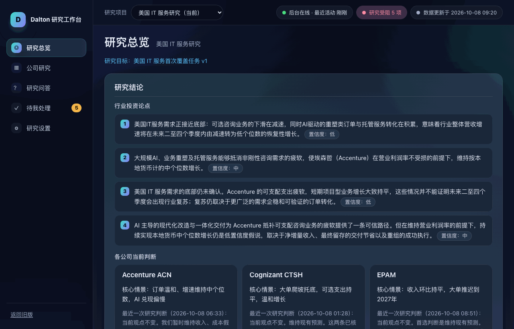
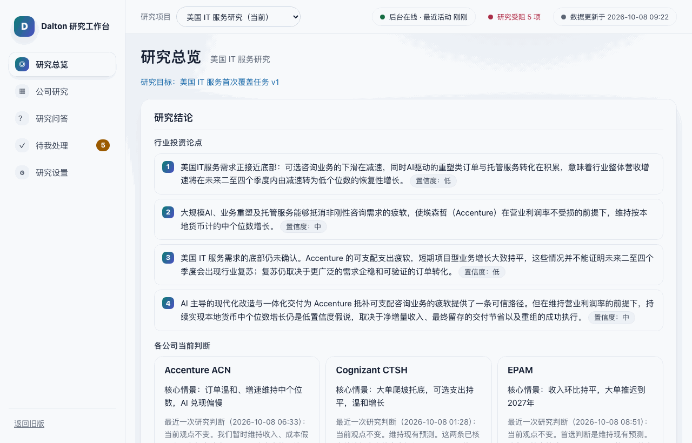
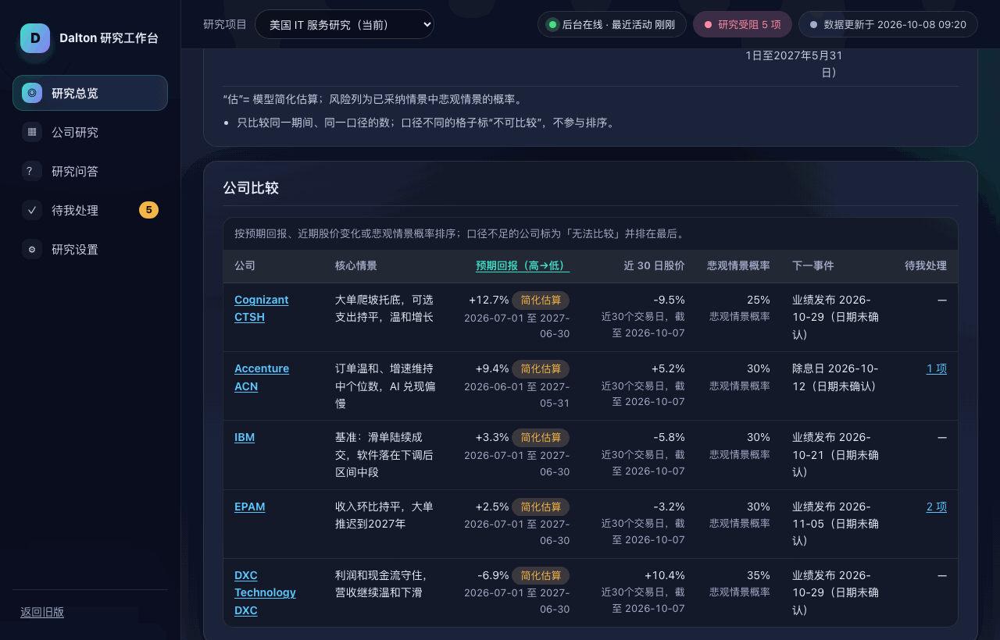
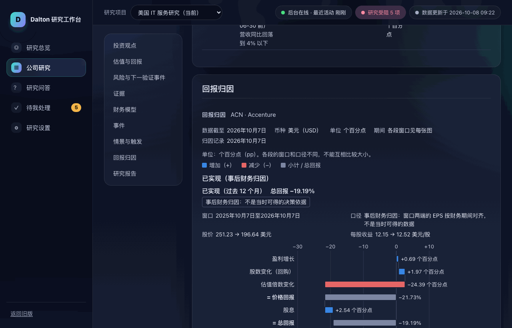
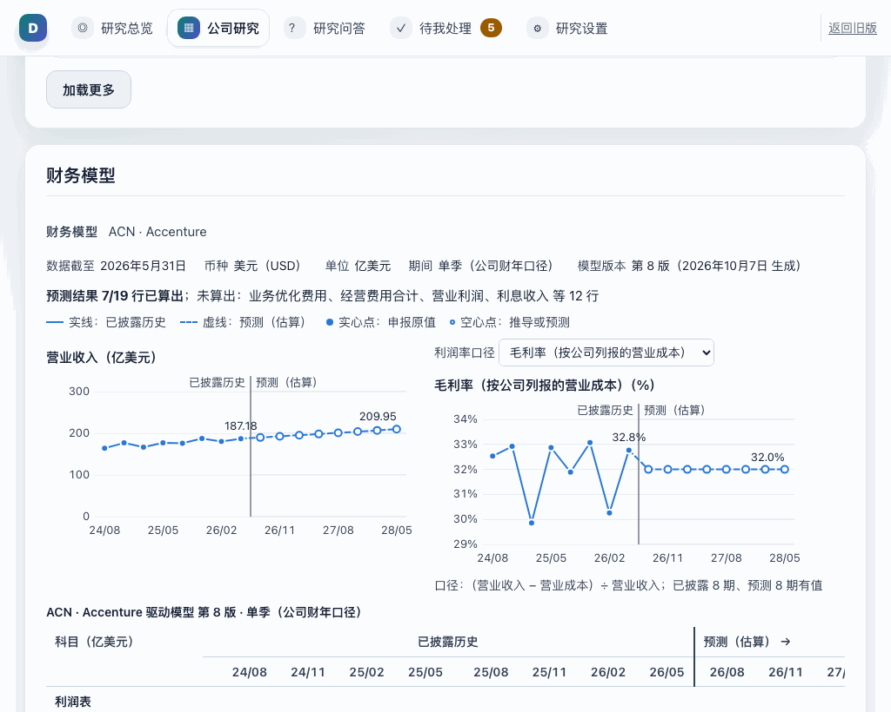
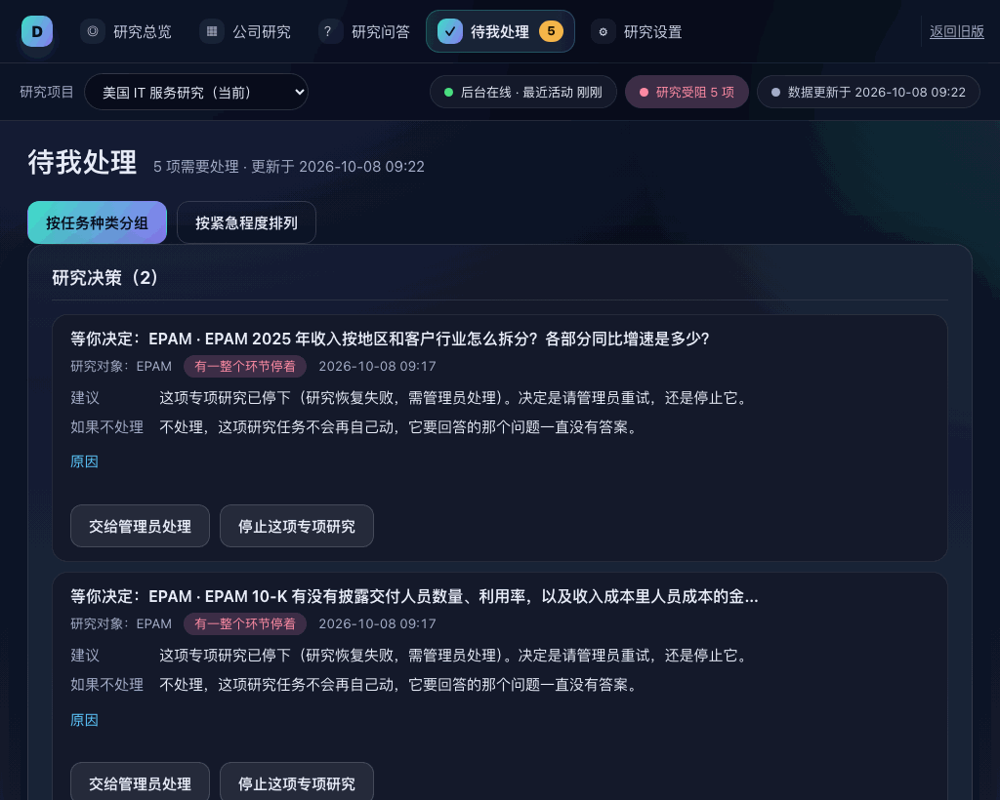
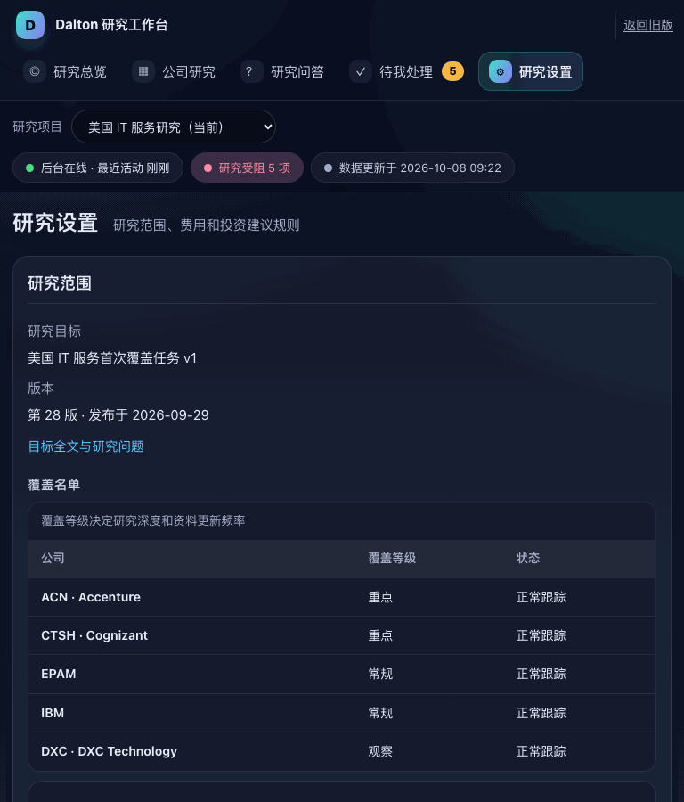
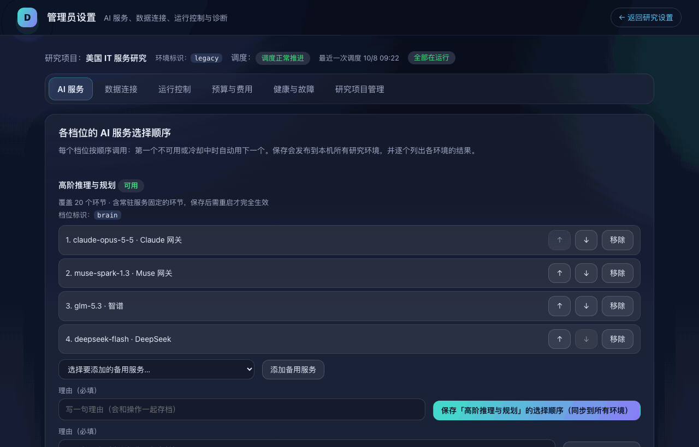
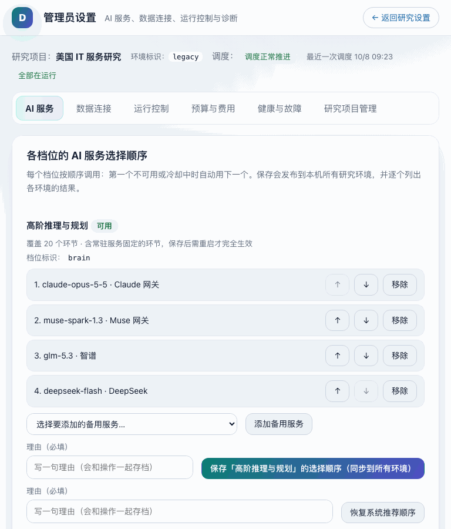
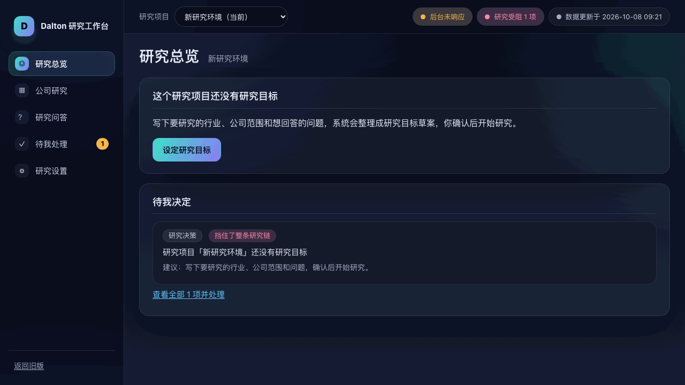

# Cockpit v2 · 用旧版设计语言重做外观（2026-10-08）

Owner 指示：「用之前的设计语言完善 v2，让其更美观」。本批只改外观与标记（`cockpit_v2/shell.*`、`pages/*.js` 的 class、`admin/admin.*`、`charts/charts.css`），不改路由、文案、ARIA 与行为。

## 设计令牌：旧版 → v2

| 角色 | 旧版 `cockpit_control.html` | v2 深色（默认） | v2 浅色（`prefers-color-scheme: light`） |
|---|---|---|---|
| 页面底色 | `--bg0/1/2` #070b16 / #0d1326 / #121a33 + 两个径向光晕 | `--v2-bg` #0d1326，同一组渐变 `--v2-page` | 旧版浅色块 #f5f7fa + 两个淡光晕 |
| 玻璃面板 | `--panel` rgba(255,255,255,.045)，`--panel2` .07，`--line` .09，`--line2` .16 | `--v2-panel` / `--v2-panel-2` / `--v2-line` / `--v2-line-2` 原值 | rgba(255,255,255,.82) / #eef2f7 / #e2e7ef / #cbd4e1 |
| 文字实际所在的合成底色（用于对比度测试） | — | surface #1d243c（.045 叠在 #121a33 上）、raised #2c3349（悬停 .11）、glow #333b63（光晕最亮处）、cell #171c2f（表格冻结列）、sheet #121a33（侧边面板） | #ffffff / #eef2f7 / #edf0f9 / #f8fafc / #ffffff |
| 正文 / 次要 / 弱化 | `--text` #e8ecf7、`--muted` #98a2c0 | ink #e8ecf7、ink-2 #c9d0e4、muted #a3adca（#98a2c0 在光晕上只有 4.25:1，提亮一级） | #172033 / #344055 / #5f6b7c（旧版 AA 调过的 `--dim`） |
| 链接 / 焦点 | `--sky` #5cc8ff | link、focus #5cc8ff | #1769aa |
| 强调与品牌渐变 | teal #3ee0c8、violet #8b7cf6、`--grad` 120° | accent #3ee0c8，grad-a/grad-b #3ee0c8 → #8b7cf6，渐变上文字 #08101f | #08756b；按钮渐变 #0b7f73 → #4f4fc4，白字（旧版浅色主按钮） |
| 状态色 | green #4ade80、amber #f5b64a、rose #ff6b8a | ok #4ade80、warn #f5b64a、danger #ff8da5（#ff6b8a 在 raised 上 4.61，在光晕上 3.97，提亮）；各自的 *-bg 是 .14 着色后的实色 | #176d43 / #8d4d00 / #a92e48 与旧版浅色底 |
| 徽标 / 危险按钮 | 琥珀徽标 #f5b64a + #1b1200；`button.danger` 玫红底粉字 | badge 同旧版；danger-btn #3d2e47 + #ffb3c3 | #9a5a00 + 白；#b4233f + 白 |
| 圆角 / 阴影 / 字体 | 卡片 18px、控件 12–14px，`0 20px 60px rgba(0,0,0,.35)`，PingFang 系统字，mono 用于代码 | 原值；正文 15px，表格 14px，徽章 13px | 阴影换成旧版浅色的 `0 12px 38px rgba(37,50,74,.08)` |

## 每页变化

- **外壳**：左侧 232px 导航栏（磨砂、D 字渐变徽标、每项一个字形图标块、当前项用旧版青紫渐变高亮、琥珀待办数徽章、底部「返回旧版」→ `/legacy`）。顶栏改为磨砂粘顶条：左侧项目切换器（圆角药丸）、右侧状态三件套（旧版 `.pill` + 状态点，正常时绿点脉动，`prefers-reduced-motion` 时不动）。≤1024 时导航栏收成顶部一排标签（旧版 ≤1000 也是这样），769–1024 隐藏品牌字只留徽标；≤768 标签换到第二行。`adminHref()` 现在返回 `/admin`（清单里有 `/admin` 或 `/v2/admin` 时都成立）。
- **研究总览**：第一屏是仪表盘：「研究结论」做成旧版 hero 卡（青紫渐变+光晕），行业论点为带渐变编号的列表，各公司判断为 3 列卡片；下面「重要变化」与「待我决定」左右并排（没有变化时「待我决定」占满一行）；再往下是覆盖公司对比图（`overview.header` 插槽，从页面顶部移到决定列表之后，后备内容改为四个统计格）和「公司比较」表。比较表的三个数字列改为右对齐的表格数字列。
- **公司页**：目录变成玻璃卡片里的胶囊列表（当前节用渐变高亮），每个章节是一张玻璃卡片；图表卡片嵌在章节里时去掉自己的卡片外框。来源与原文面板按旧版阅读器 sheet 做：渐变底、20px 圆角、粘顶标题栏；≥1281 时在右侧并排，≤1280 时为右侧抽屉。
- **待我处理 / 研究问答 / 研究设置**：同一套卡片、标签、按钮（渐变主按钮、玻璃次按钮、描边安静按钮）、输入框（深色底、聚焦时青色描边）、表格（表头 panel2 底、行悬停、冻结列底色一致）。设置页里「旧版工作台」链接改为 `/legacy`。
- **管理员页 `/v2/admin`**：同样的深色/浅色令牌；顶栏加 D 徽标；分区标签改为一个玻璃容器里的分段控件；分区卡片、指标格、表格、危险区、命令块、链条列表都用旧版样式。顺带修了一个旧问题：「理由」输入框跟随 label 的 `flex:1 1 280px` 被纵向撑到约 280px 高。
- **图表**：外观令牌改用外壳的深蓝/浅色令牌（墨色、网格线、坐标轴、预测区底色、边界线），图表卡片与页面玻璃面板对齐；数据颜色仍是 dataviz 参考色阶。顺带修了图表被缩小的问题：股价迷你图和财务模型的两张小图按容器宽度绘制，但之前的网格把它们压进更窄的列里，刻度文字被缩到约 8px；现在它们按绘制宽度显示，放不下时换行到下一行。情景表的「类型/观察方」列不再一个字一行。历史/预测边界、印出的正负号、截至日期/币种/单位/期间行都没动；图表里仍然没有渐变、阴影、3D 和动画。

## 对比度（两种主题）

`tests/test_cockpit_v2_shell.py::StaticChecks.test_colour_pairs_meet_aa` 现在分别读取深色（`:root`）和浅色（`@media (prefers-color-scheme: light)`）两组令牌，检查 65 对组合：8 种文字色 × 6 种底色（bg、surface、raised、glow、cell、sheet），再加上按钮、徽章和着色底上的文字。

- 外壳深色：65/65 ≥ 4.5:1，最低是 muted 在光晕上 4.82:1；正文在面板上 12.97:1。
- 外壳浅色：65/65，最低是 muted 在 glow 上 4.75:1；正文 16.27:1。浅色强调色从 #087f73 调到 #08756b，因为前者在 raised 底上只有 4.35:1。
- 管理员页（新增 `AdminStyleTests`，24 对）：深色最低 5.48:1，浅色最低 4.81:1。
- 图表（新增 `test_chart_text_and_marks_contrast_in_both_themes`）：墨色、次要墨色、弱化色在 surface、plane、预测区底色上都 ≥ 4.5:1；增加、减少、合计的柱色和单一序列色在 surface 上都 ≥ 3:1。
- 颜色不单独表达含义：涨跌仍印正负号，状态仍带文字或图标，状态点旁都有文字。

## dataviz 校验器

按 dataviz skill 的深色模式规则：同一色阶为深色选定单独的色阶（深色另选色阶，不是自动反色），并对图表实际所在的底色重新校验：

| 色板 | 模式 | 底色 | 结果 |
|---|---|---|---|
| #2a78d6, #e34948 | light | #ffffff | 全部通过（CVD ΔE 21.6，正常视觉 32.3，均 ≥ 3:1） |
| #3987e5, #e66767 | dark | #1d243c（玻璃合成色） | 全部通过（CVD ΔE 19.2，正常视觉 29.0，均 ≥ 3:1） |
| #3987e5, #e66767 | dark | #232a41（plane / 预测列） | 全部通过 |

设置 `DATAVIZ_VALIDATOR` 后，`test_palette_passes_the_dataviz_validator_when_available` 会运行这三组检查（本次已运行，通过）。

## 自查截图

在无头 Chromium 中检查了 8 个页面：总览、ACN 公司页、待我处理、研究问答、研究设置、管理员页、空白工作区、ws-7d 总览。每页都在 1280、1024、768 三个宽度和深浅两种主题下截图，共 48 张，均无横向溢出、无控制台错误。另外单独检查了侧边面板的打开和 Esc 关闭（焦点回到打开它的按钮）、深色下导航和排序按钮的焦点环。截图通过一个只读 GET 代理取得：前端文件来自工作树，数据来自正在运行的实例，所有非 GET 请求一律返回 405。

