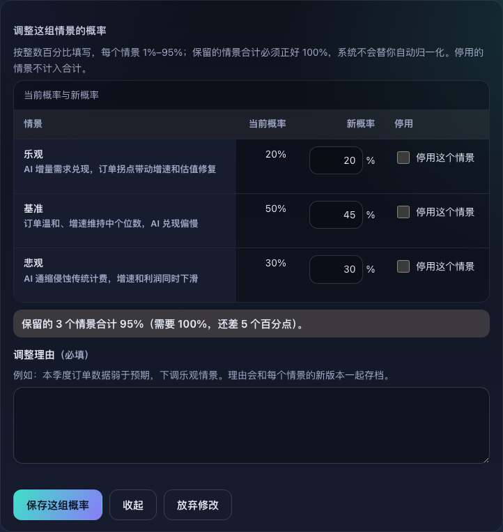
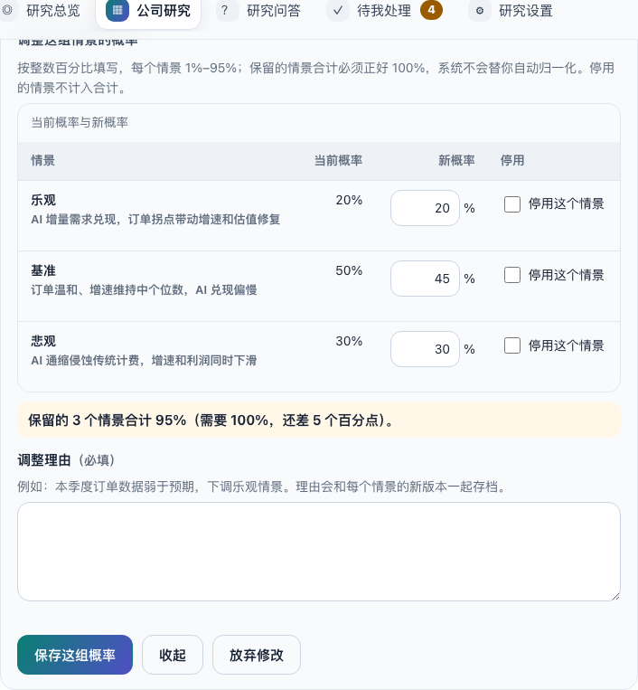
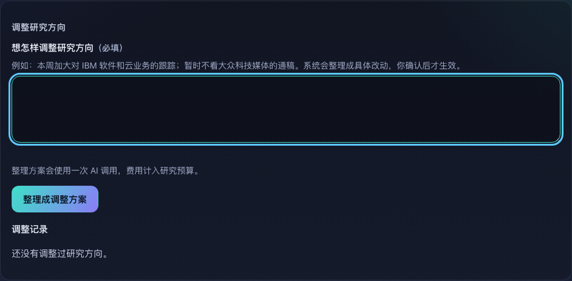
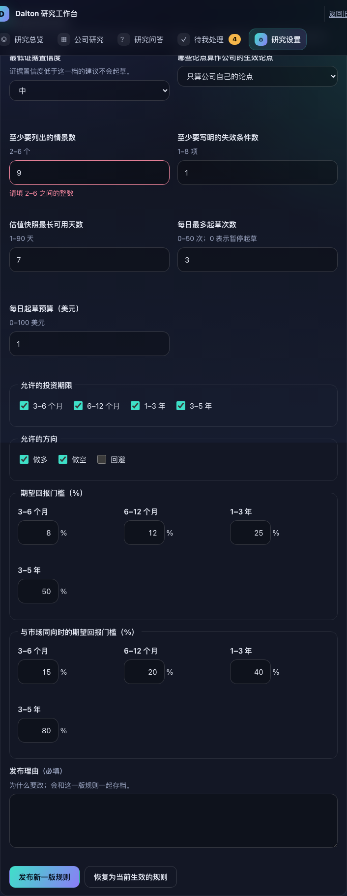
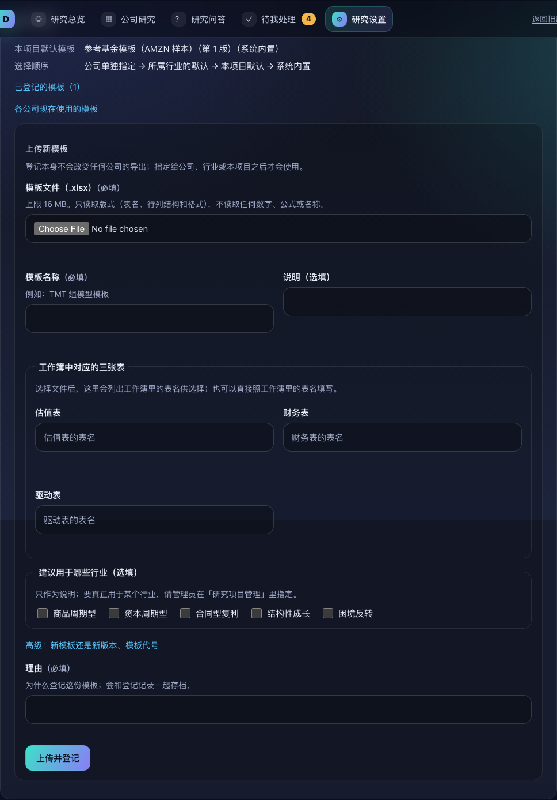
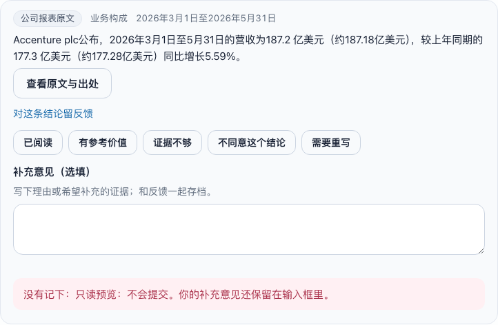
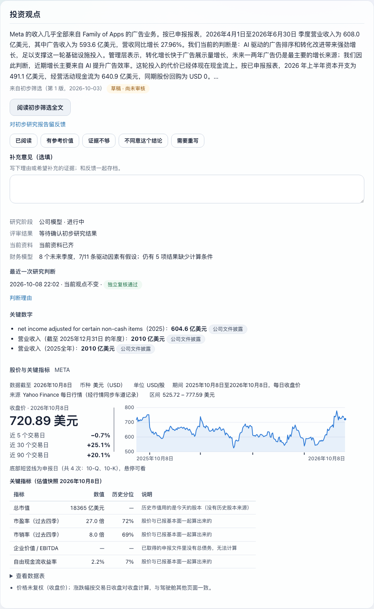
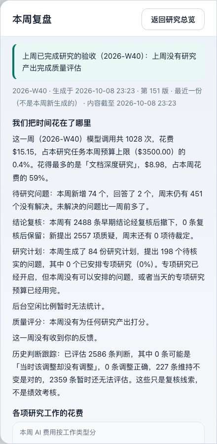
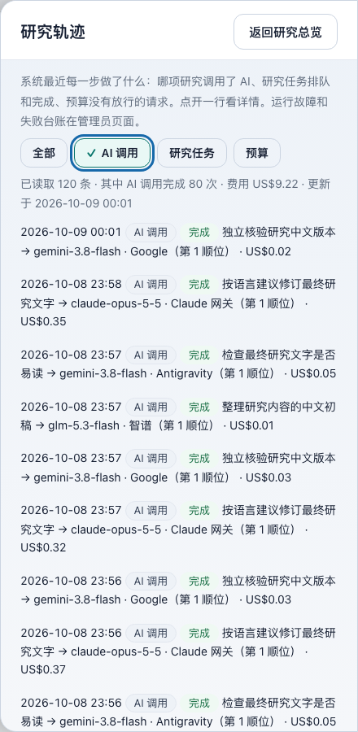
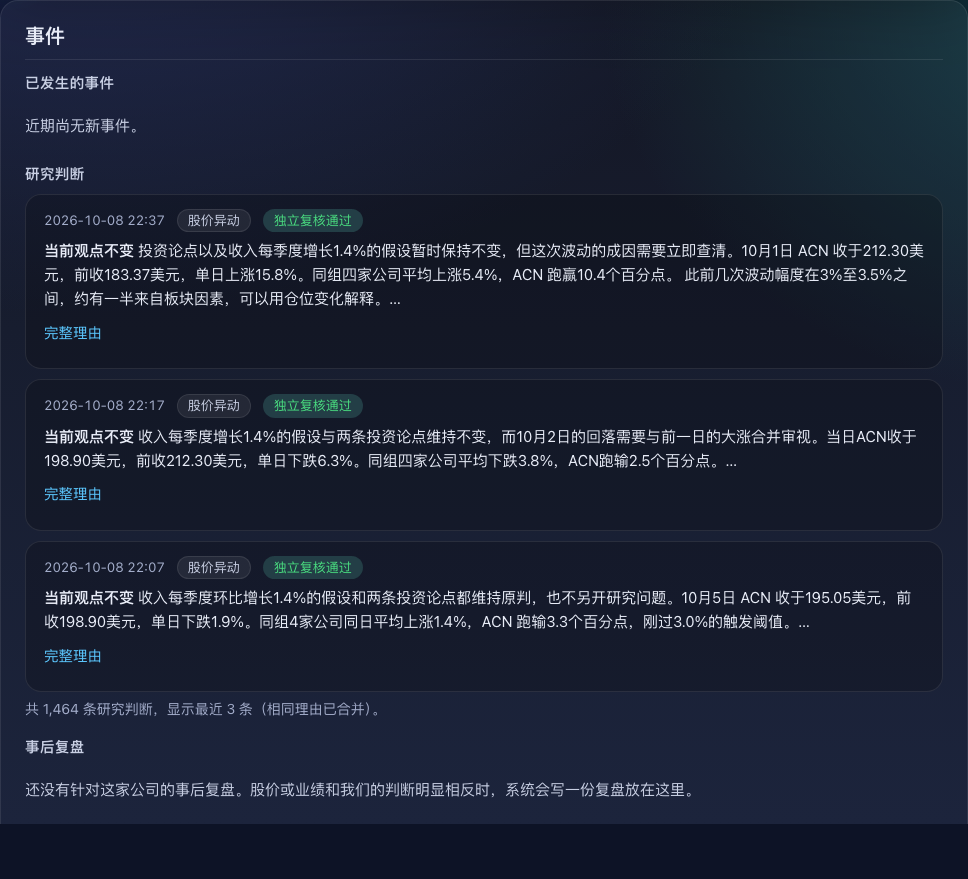

# Cockpit v2 · 把只在旧版的功能迁到新版（2026-10-08）

Owner 指示：「你说的那些项目也都迁移过来吧」。本批把只能在 `/legacy` 办理的功能逐项搬进新版（`/` 与 `/admin`），分析师日常不再需要打开旧版。旧版 `cockpit_control.html` 一行未改，继续作为后备留在 `/legacy`。

原则：

- **写入**：只复用已有的 `/v1/cockpit/*` 写入口和 writer 操作，以 owner 的 `human:` 身份执行，CSRF 与外壳一致。没有新增任何写路径。
- **读取**：只新增一个读接口 `GET /v2/data/feedback`（`cockpit_v2/feedback_data.py`，经 `V2Router` 注册）。原因是 `/v1/cockpit/claims` 不带反馈要绑定的内容哈希。
- **交互**：沿用批次 ab 的规则：
  - 草稿不丢（sessionStorage，刷新、换页都保留）。
  - 行内校验，字段不对时什么也不发送。
  - 回执留在对象上，按钮都是原生控件。
  - 打开、关闭、校验失败时有焦点管理。
  - 每个新子视图都有稳定的 hash 地址。
- **外观**：沿用批次 ad 的视觉令牌。新增 CSS 约 30 行，只用现有 token：开关按钮、复选框组、行内数字框、合计行、抽屉列表。

## 迁移对照表

| 旧版功能 | 新版位置 | 地址 | 复用的写入口 / 读取 |
|---|---|---|---|
| 上传基金 Excel 模板 | 研究设置 → 报告模板 → 上传新模板 | `/#/settings?focus=templates` | `POST /v1/cockpit/fund_template_register`（大文件通道） |
| 自然语言方向调整（steer）及其历史 | 研究设置 → 研究范围 → 调整研究方向 | `/#/settings?focus=steer` | `POST /v1/cockpit/steer` → `publish` / `decide`（`draft:steer`）；`GET history?kind=steer` |
| 编辑并发布投资建议规则 | 研究设置 → 投资建议规则 → 编辑投资建议规则；版本列表与两版对比 | `/#/settings?focus=rules`，对比 `&left=…&right=…` | `POST /v1/cockpit/conviction_policy`（带 `prior_version_ref`）；`GET conviction-policy?left=&right=` |
| 对单条结论反馈：初步研究报告 | 公司页 → 投资观点 →「对初步研究报告留反馈」 | `/#/company/<代码>/view` | `POST /v1/cockpit/feedback`（`initial_screen`） |
| 对单条结论反馈：每条证据（新增，旧版没有逐条） | 公司页 → 证据 → 每条下的「对这条结论留反馈」 | `/#/company/<代码>/evidence` | `POST /v1/cockpit/feedback`（`claim`）；绑定来自 `GET /v2/data/feedback` |
| 对单条结论反馈：问答回答 | 研究问答：当前回答直接显示；历史回答折叠显示 | `/#/ask` | `POST /v1/cockpit/feedback`（`ask_answer`） |
| 情景修订（调整概率、停用情景） | 公司页 → 情景与触发 →「调整情景概率」：一张表改整组 | `/#/company/<代码>/scenarios?edit=probabilities` | `POST /v1/cockpit/scenario_revise`，每个改动的情景一次 |
| 研究轨迹 | 研究总览 → 研究记录 →「研究轨迹」抽屉：按类型筛选、逐行展开、加载更早 | `/#/overview?panel=trajectory&kind=call` | `GET /v1/cockpit/trajectory` |
| 每周运行复盘 | 研究总览 → 研究记录 →「本周复盘」抽屉，附上周已完成研究的验收 | `/#/overview?panel=reflection` | `GET /v1/cockpit/reflection`；候选问题可一键写进「调整研究方向」（只填文字，仍需确认） |
| 公司复盘、专项研究、跟踪频率、初步业绩 | 公司页 → 事件 → 公司初步业绩 / 事后复盘 / 正在进行的专项研究 / 数据更新与跟踪频率 | `/#/company/<代码>/events` | 读 overview 已有字段 |
| 运行详情（运维待办：逐件的失败台账） | 管理员 → 健康与故障 →「失败台账 · 明细」：等待外部服务、等待授权、已停止的尝试、历史分页。按流程汇总的四格 B 已有，不重复 | `/admin#health` | `GET /v1/cockpit/ops` |
| 每周简报设置入口 | 研究设置 → 每周简报；本周复盘抽屉底部也有链接 | `/#/settings?focus=brief` → `/weekly-brief` | — |
| 各公司指定导出模板、按所选模板临时导出 | 公司页 → 财务模型 → 导出财务模型。导出按钮移到图表插槽之外，图表模块接管表格时也不会丢失 | `/#/company/<代码>/model` | `GET export?template=`；`POST /v1/cockpit/fund_template_select`（`company` 范围，理由必填） |
| 审批卡上的判断依据 | 待我处理：每张审批卡显示以下内容（第 8 项排查时发现，旧版有、新版缺）：投资建议三部分（证据置信度、情景与期望回报、与市场看法、失效条件）、投资备忘录核验依据、从零复盘全文、相关复盘、上一版审阅意见、本版改动 | `/#/tasks` | 读 approvals 已有字段；决定仍走 `POST decide` |
| 研究计划、目标历史版本 | 研究设置 → 研究范围 →「系统接下来的研究安排」、「研究目标的历史版本」 | `/#/settings?focus=plan` | 读 overview 已有字段 |
| 结论全部历史版本（审计视图） | 公司页 → 证据 →「显示全部历史版本」 | `/#/company/<代码>/evidence?versions=all` | `GET claims?canonical=0` |

已经在新版、本批没有动的功能：

- **新版管理员页**（批次 ac B）已有：
  - 模型链、预算、核验独立性、资料来源。
  - 运行控制：暂停/恢复、停止专项研究、提高频率、覆盖名单草案、紧急停机。
  - 项目默认与行业模板选择、重试语言质检、新建/重命名项目。
  - 运行记录（日志筛选）。
- **分析师页**已有：目标草案、问答、审批决定。
- 管理员页「研究项目管理」底部原来写着「上传新模板仍在原投研工作台」，现已改为指向 `/#/settings?focus=templates`。

## 交互要点

- **情景（Q02）**：
  - 不用浏览器 prompt，乐观、基准、悲观三行同表编辑，每个情景可勾选停用。
  - 合计实时显示（例如「还差 5 个百分点」），格式为 1–95 的整数百分比，合计必须正好 100%，不自动归一化。
  - 理由必填（≤600 字），这与 writer 的限制一致。
  - 概率按小数发送（例如 `0.45`），避免服务端把 `1` 当成 100%。
  - 每一行的 request id 随草稿保存，断线后重试会回放，不会重复写入。
  - 部分失败时：已保存的行写进回执，未保存的行留在表单里。
  - 成功后表单收起，回执留在「情景与触发」上并获得焦点。
- **反馈**：
  - 五种判断：已阅读 / 有参考价值 / 证据不够 / 不同意这个结论 / 需要重写，已给过的按下显示。
  - 补充意见选填（≤4000 字），草稿保存。
  - 回执写明「反馈不是审批，不会直接改变这条结论」。
  - 反馈记录没开通的项目不显示按钮，只给一句说明。
- **投资建议规则**：
  - 每个字段都有范围和行内错误，例如「与市场同向的门槛不能低于一般门槛（12%）」。
  - 未发布的修改按版本保存。若期间有人发布了新版，旧修改作废并给出提示。
  - 发布回执保留在「投资建议规则」区。
- **报告模板**：
  - 在浏览器里读取所选 .xlsx 的工作表名，下拉选择估值表、财务表、驱动表，并按表名预选。读不出时改为手填。
  - 模板代号自动生成；「高级」里可以选「已有模板的新版本」。
  - 文件类型、大小上限、名称、理由都行内校验。
- **抽屉**：
  - 关闭按钮或 Esc 关闭，地址去掉 `panel`，焦点回到打开它的链接。
  - 外壳 `side.open` 新增 `onClose`，换页时静默关闭。

## 仍留在 `/legacy` 的

- **旧版整页本身**：作为后备保留，行为不变，顶栏说明也不改（按指示）。
- **`/legacy/review`**（ADR-0006 运维审阅页）：不属于旧版投研工作台，留在原处。
  - 内容是 ADR-0009 退役的议程与早期文档审阅流程的历史记录。
  - 其中的人工抽取、引用坐标、writer 重提交属于已退役的管理流程；审查报告 Z02–Z06 也建议归档，而不是迁移。

除此以外，`cockpit_control.html` 里的每个 `/v1/cockpit/<操作>` 写入和每个阅读面板，新版都有对应入口，逐项见上表与本节开头。

## 验证

- **页面测试**：`tests/test_cockpit_v2_migration.py`，41 项，用 node 和假 DOM 驱动页面。
  - 覆盖反馈、情景、方向调整、规则、模板上传、导出模板、审批依据、抽屉。
  - 每项都检查：发出的请求体、校验失败时不发送、回执、草稿保留与恢复。
  - 另含 `/v2/data/feedback` 的单元测试。
  - 测试工具 `tests/cockpit_v2_harness.mjs` 增加了交互步骤、事件冒泡、`<select>` 取值和 `call` 命令。
- **canary**：`tests/test_cockpit_v2_routes.py` 增加了新的读取路径。空白工作区里的所有 v2 GET 都没有 5xx。
- **浏览器截图**：无头 Chromium，经只读 GET 代理（前端用工作树，数据来自运行中的实例，非 GET 一律 405）。
  - 14 个视图 × 1280/1024/768 × 深浅两色，共 84 张。
  - 没有横向溢出，没有脚本错误。
- **浏览器交互**：21 项全部通过，包括：
  - 抽屉开关、Esc、焦点回位、地址同步。
  - 情景表单的实时合计、收起后草稿恢复、被拒写入时表单保留。
  - 规则对比在原位更新，已写的方向调整文字不丢。
  - 证据反馈真实发出了 POST，被代理以 405 拒绝，页面就地显示「没有记下……」。没有任何写入到达实例。

